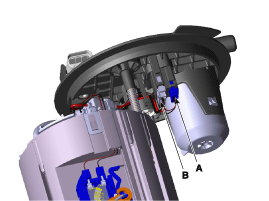
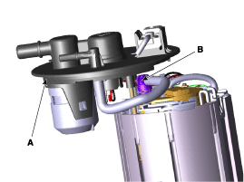
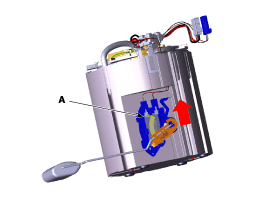
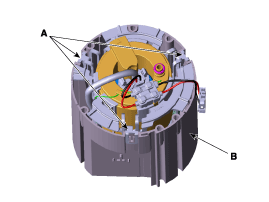
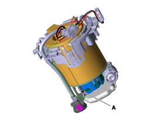
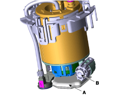
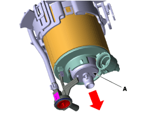
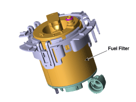

# Filtro de combustível — procedimentos

[Home](../../index.md) / [Manual de Serviço e Reparo](../sportage-482.md) / [Motorização NU](index.md) / Filtro de combustível — procedimentos

## Remoção

1. Remova o bomba de combustível.

   (Consulte o Sistema de Entrega de Combustível - "Bomba de Combustível")

2. Desconecte o conector de alimentação elétrica do bomba (A) e o conector do indicador de nível de combustível (B).

   

3. Remova a montagem da cabeça (A) após soltar as enganches do amortecedor.

4. Desconecte os conectores rápido das mangueiras de combustível (B).

   

5. Remova o indicador de nível de combustível (A) na direção do seta.

   

6. Remova a tampa do reservatório (B) após soltar os enganches de fixação (A).

   

7. Desconecte o terço de solo (A).

   

8. Solte os enganches de fixação e, em seguida, remova o pré-filtro (A) e o regulador de pressão do combustível (B).

   

9. Remova o motor da bomba de combustível (A) na direção do seta.

   

   

   > **Cuidado**
   >
   > - Tenha cuidado com o anel de vedação.

## Instalação

1. A instalação é o inverso da remoção.
