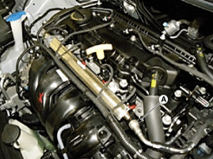
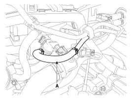
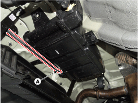
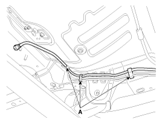
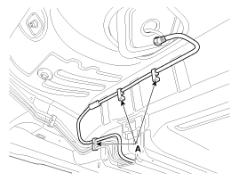
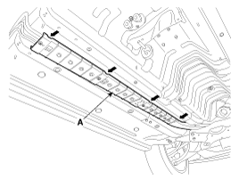
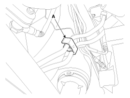
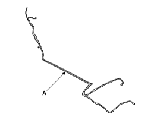

# Kia Sportage SL: Motorização NU / Fuel Line Repair procedures

[Home](../../index.md) / [Kia Sportage SL Service & Repair Manual](../sportage-482.md) / [Motorização NU](index.md) / Fuel Line Repair procedures

## Remoção

1. Desligue o interruptor de ignição, e depois remova o cabo do bocal (-) da bateria.

2. Libere a pressão residual na linha de combustível.

   (Consulte Sistema de Entrega de Combustível - "Libere a Pressão Residual na Linha de Combustível")

3. Desconecte o conectador rápido de alimentação de combustível (A).

   

4. Desconecte o tubo de vapor (A) que está conectado ao PCSV.

   

5. Levante o veículo.

6. Remova o tanque de combustível.

   (Consulte Sistema de Entrega de Combustível - "Tanque de Combustível")

7. Desconecte o conectador rápido do tubo de vapor (A).

   

8. Remova o clip de fixação do tubo de vapor (A).

   

9. Remova o clip de fixação da linha de alimentação de combustível (A).

   

10. Desconecte o protegente de linha de combustível e freio (A) do clip de fixação.

    

11. Remova o clip de fixação da linha de combustível (A).

    

12. Remova a linha de combustível (A).

    

## Instalação

1. A instalação é o contrário da remoção.
