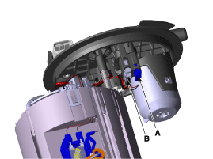
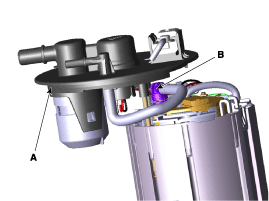
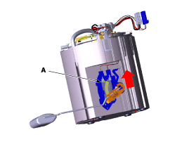
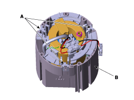
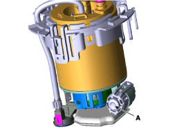
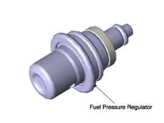

# Regulador de pressão de combustível — procedimentos

[Home](../../index.md) / [Manual de Serviço e Reparo](../sportage-482.md) / [Motorização NU](index.md) / Regulador de pressão de combustível — procedimentos

## Remoção

1. Remova o bomba de combustível.

   (Consulte o Sistema de Entrega de Combustível - "Bomba de Combustível")

2. Desconecte o conectador de alimentação elétrica do bomba (A) e o conectador do indicador de nível de combustível (B).

   

3. Remova a montagem do cabeçote (A) após soltar as enganches do amortecedor.

4. Desconecte os conectores rápido de conexão do tubo de combustível (B).

   

5. Remova o indicador de nível de combustível (A) na direção do seta.

   

6. Remova a tampa do reservatório (B) após soltar os enganches de fixação (A).

   

7. Solte os enganches de fixação e, em seguida, remova o regulador de pressão de combustível (A).

   

   

## Instalação

1. A instalação é o inverso da remoção.
