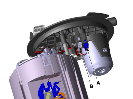
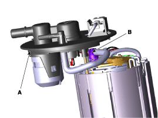
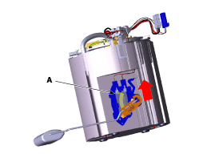
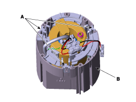
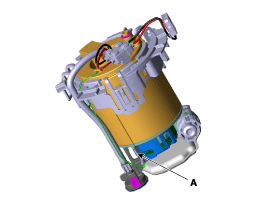
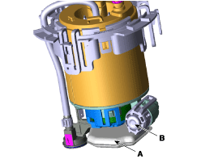
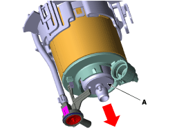
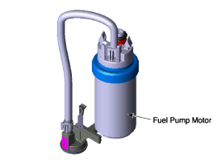

# Motor da bomba de combustível — procedimentos

[Home](../../index.md) / [Manual de Serviço e Reparo](../sportage-482.md) / [Motorização NU](index.md) / Motor da bomba de combustível — procedimentos

## Remoção

1. Remova a bomba de combustível.

   (Consulte o Sistema de Entrega de Combustível - "Bomba de Combustível")

2. Desconecte o conectador de alimentação elétrica do motor da bomba (A) e o conectador do nível do combustível (B).

   

3. Remova a montagem da cabeça (A) após soltar as enganchas do amortecedor.

4. Desconecte os conectores rápido das mangueiras de combustível (B).

   

5. Remova o indicador do nível do combustível (A) na direção do seta.

   

6. Remova a tampa do reservatório (B) após soltar as enganches de fixação (A).

   

7. Desconecte o terço de solo (A).

   

8. Solte as enganches de fixação e, em seguida, remova o filtro pré-filtro (A) e o regulador de pressão do combustível (B).

   

9. Remova o motor da bomba de combustível (A) na direção do seta.

   

   

## Instalação

1. A instalação é o inverso da remoção.
