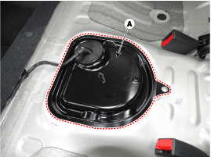
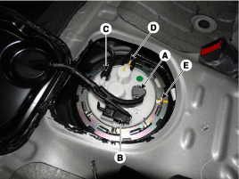
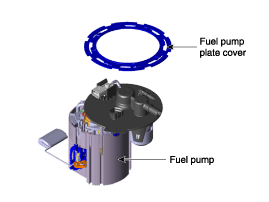

# Bomba de combustível — procedimentos

[Home](../../index.md) / [Manual de Serviço e Reparo](../sportage-482.md) / [Motorização NU](index.md) / Bomba de combustível — procedimentos

## Remoção

1. Libere a pressão residual na linha de combustível.

   (Consulte o Sistema de Entrega de Combustível - "Libere a Pressão Residual na Linha de Combustível")

2. Remova o banco traseiro.

   (Consulte o Corpo - "Montagem do Banco Traseiro")

3. Remova a capa de serviço da bomba de combustível (A).

   

4. Desconecte o conector da bomba de combustível (A) e o conector do sensor de pressão do tanque de combustível (B).

5. Desconecte o conectador rápido do tubo de alimentação de combustível (C) e o conectador rápido do tubo de vapor (D).

6. Remova a bomba de combustível do tanque de combustível após remover o anel de bloqueio (E) com SST[SST.: 09310-F3100].

   

7. Remova a bomba de combustível do tanque de combustível.

   

## Instalação

1. A instalação é o inverso da remoção.

   > **Cuidado**
   >
   > - Tenha cuidado com a direção da bomba de combustível ao instalar (Consulte o trinco no tanque de combustível).

   ```
   Instalação da Capa de Cobertura da Placa da Bomba de Combustível :
   58,8 ~ 68,6 N.m (6,0 ~ 7,0 kgf.m, 43,3 ~ 50,6 lb-ft)
   ```
