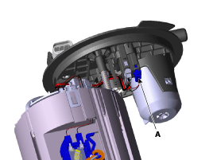
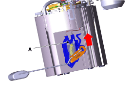
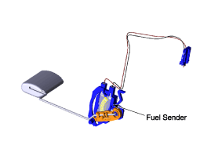

# Kia Sportage SL: Motorização NU / Fuel Sensor Repair procedures

[Home](../../index.md) / [Kia Sportage SL Service & Repair Manual](../sportage-482.md) / [Motorização NU](index.md) / Fuel Sensor Repair procedures

## Remoção

1. Remova o bomba de combustível.

   (Consulte o Sistema de Entrega de Combustível - "Bomba de Combustível")

2. Desconecte o conector do sensor de nível de combustível (A).

   

3. Remova o sensor de nível de combustível (A) na direção do setor.

   

   

## Instalação

1. A instalação é o contrário da remoção.
