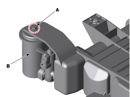
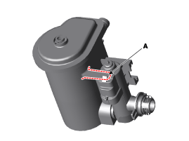
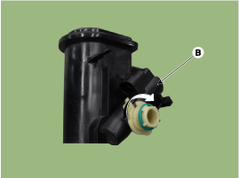

# Filtro de ar do tanque de combustível — procedimentos

[Home](../../index.md) / [Manual de Serviço e Reparo](../sportage-482.md) / [Motorização NU](index.md) / Filtro de ar do tanque de combustível — procedimentos

## Remoção

1. Desligue o interruptor de ignição e desconecte o terminal negativo (-) da bateria.

2. Remova a montagem do canister.

   (Consulte Sistema de Controle de Emissão - "Canister")

3. Remova a viga de fixação (A), e então remova o filtro de ar (B).

   

4. Libere a viga (A), e então separe o válvula de fechamento do canister (B) do filtro de ar do tanque de combustível, rotacionando-o na direção do seta na figura.

   

   

5. Instale um novo filtro de ar do tanque de combustível de acordo com o contrário do procedimento de remoção.

## Instalação

1. A instalação é o contrário da remoção.
