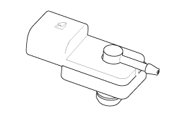

# Sensor de pressão do tanque (FTPS) — descrição e operação

[Home](../../index.md) / [Manual de Serviço e Reparo](../sportage-482.md) / [Motorização NU](index.md) / Sensor de pressão do tanque (FTPS) — descrição e operação

## Descrição

Sensor de Pressão do Tanque de Combustível (FTPS) é um componente do sistema de emissões evaporativas e está instalado no tanque de combustível, na bomba de combustível ou no cânister. Ele verifica a operação do solenoide de controle de purga e detecta uma fuga no sistema.

