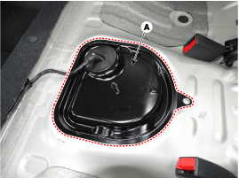
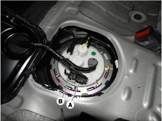

# Kia Sportage SL: Motorização NU / Fuel Tank Pressure Sensor (FTPS) Repair procedures

[Home](../../index.md) / [Kia Sportage SL Service & Repair Manual](../sportage-482.md) / [Motorização NU](index.md) / Fuel Tank Pressure Sensor (FTPS) Repair procedures

## Inspeção

1. Conecte o GDS na Conector de Interface de Dados (CID).

2. Medir a tensão de saída do FTPS.

   ```
   Especificação : Consulte "Especificação"
   ```

## Remoção

1. Desligue a chave do motor e desconecte o cabo negativo (-) da bateria.

2. Remova o banco traseiro.

   (Consulte Corpo - "Montagem do Banco Traseiro")

3. Remova a tampa de serviço do bomba de combustível (A).

   

4. Desconecte o conector do sensor de pressão do tanque de combustível (A).

5. Remova o sensor de pressão do tanque de combustível (B) após soltar as garras verticalmente.

   

## Instalação

> **Cuidado**
>
> - Instale o componente com as torques especificadas.
> - Tenha em mente que danos internos podem ocorrer se o componente cair. Neste caso, utilize após inspeção.

> **Cuidado**
>
> - Insira o sensor na abertura de instalação e tenha cuidado para não danificar durante a instalação.

1. A instalação é o inverso da remoção.
