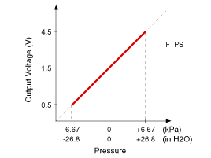

# Kia Sportage SL: Motorização NU / Fuel Tank Pressure Sensor (FTPS) Specifications

[Home](../../index.md) / [Kia Sportage SL Service & Repair Manual](../sportage-482.md) / [Motorização NU](index.md) / Fuel Tank Pressure Sensor (FTPS) Specifications

## Especificação

| Pressão [kPa (kgf/cm?, in H2O)] | Vítreo de Saída (V) |
| --- | --- |
| -6,67 (-0,068, -26,8) | 0,5 |
| 0 | 2,5 |
| +6,67 (0,068, 26,8) | 4,5 |

