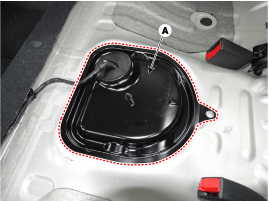
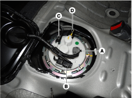
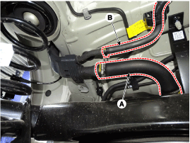
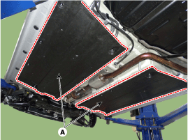
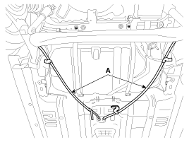
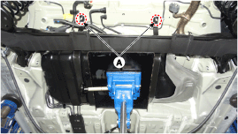

# Tanque de combustível — procedimentos

[Home](../../index.md) / [Manual de Serviço e Reparo](../sportage-482.md) / [Motorização NU](index.md) / Tanque de combustível — procedimentos

## Remoção

1. Libere a pressão residual na linha de combustível.

   (Consulte Sistema de Entrega de Combustível - "Libere a Pressão Residual na Linha de Combustível")

2. Remova o encosto do assento traseiro.

   (Consulte Corpo - "Montagem do Assento Traseiro")

3. Remova a tampa de serviço do bomba de combustível (A).

   

4. Desconecte o conector do bomba de combustível (A) e o conector do sensor de pressão do tanque de combustível (B).

5. Desconecte o quick-connector da tubulação de alimentação do combustível (C).

6. Desconecte o quick-connector da tubulação de vapor (D).

   

7. Remova a roda traseira esquerda e o pneu (A).

8. Levante o veículo e apoie o tanque de combustível com um garfo.

9. Desconecte a mangueira do tanque de combustível (A).

10. Desconecte a mangueira de ventilação (B).

   

11. Remova a cobertura inferior (A).

   

12. Remova as parafusos de montagem do suporte do tubo de freio (A).

   

13. Remova o tanque de combustível do veículo após remover a fita de fixação do tanque (A).

   

   > **Nota**
   >
   > - Ao remover o tanque de combustível, ele deve ser inclinado devido à interferência com a conexão.

## Instalação

1. A instalação é o inverso da remoção.

   ```
   Parafuso de instalação da fita do tanque:
   39,2 ~ 54,0 N.m (4,0 ~ 5,5 kgf.m, 28,9 ~ 39,8 lb-ft)
   ```
