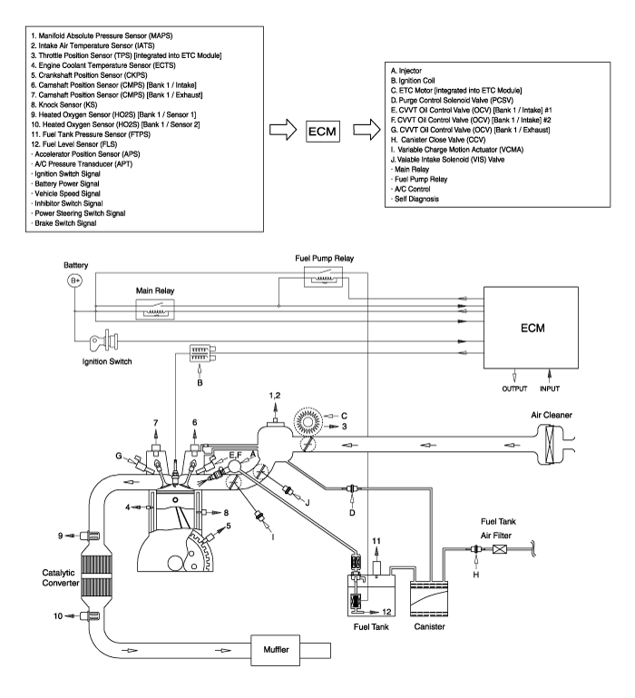
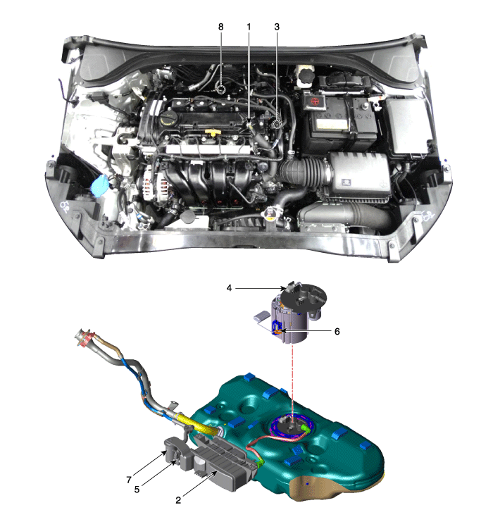

# Kia Sportage SL: Motorização NU / General Information

[Home](../../index.md) / [Kia Sportage SL Service & Repair Manual](../sportage-482.md) / [Motorização NU](index.md) / General Information

## Descrição e Operação

## Descrição

O Sistema de Controle de Emissão consiste em três sistemas principais.

| - | O Sistema de Controle de Emissão do Casco previne a liberação de gases de passagem do motor para a atmosfera. Este sistema recicla o gás de volta para o manifold de admissão (Tipo de Ventilação do Casco Fechado). |
| --- | --- |

| - | O Sistema de Controle de Emissão Evaporativo previne a liberação de gases evaporativos para a atmosfera. Este sistema queima o gás em condições de operação do motor apropriadas após coletá-lo em um canister. |
| --- | --- |

| - | O Sistema de Controle de Emissão do Exaustor converte os três poluentes [hidrocarbonetos (HC), monóxido de carbono (CO) e óxidos de nitrogênio (NOx)] em substâncias inofensivas usando o catalisador trifásico. |
| --- | --- |

## Especificações

## Especificações

Valvula de Controle de Purga (PCSV)

? Especificação

| Item | Especificação |
| --- | --- |
| Resistência do Bobinado (?) | 22,0 ~ 26,0 [20°C(68°F)] |

Sensor de Pressão do Tanque de Combustível (FTPS)

? Tipo: Sensor de Pressão Piezo-Resistivo

? Especificação

| Pressão [kPa (kgf/cm?, in H2O)] | Válvula de Saída de Voltagem (V) |
| --- | --- |
| -6,67 (-0,068, -26,8) | 0,5 |
| 0 | 2,5 |
| +6,67 (0,068, 26,8) | 4,5 |

Valvula de Fechamento do Canister (CCV)

? Especificação

| Item | Especificação |
| --- | --- |
| Resistência do Bobinado (?) | 19,5 ~ 22,5 [20°C(68°F)] |

## Torques de Aperto

| Item | kgf.m | N.m | lb-ft |
| --- | --- | --- | --- |
| Instalação da Valvula de Ventilação do Casco Positiva | 0,2 ~ 0,3 | 1,96 ~ 2,94 | 1,45 ~ 2,17 |
| Parafuso/estaca do Canister | 2,0 ~ 3,0 | 19,6 ~ 29,4 | 14,5 ~ 21,7 |

## Diagnóstico

## Diagnóstico

| Sintoma | Área Suspeita |
| --- | --- |
| Motor não arranca ou difícil de arrancar | Mangueira de vapor danificada ou desconectada |
| Motor difícil de arrancar | Falha na Valvula de Controle de Purga (PCSV) |
| Velocidade de rotação irregular ou motor cai | Mangueira de vapor danificada ou desconectada |
| Falha na Valvula de Controle de Ventilação do Casco (PCV) |  |
| Velocidade de rotação irregular | Falha no Sistema de Controle de Emissão Evaporativo |
| Consumo excessivo de óleo | Linha de ventilação do casco do motor entupida |

## Diagramas Schematicos

## Diagrama Schematico

## Componentes e Localização dos Componentes

## Localização dos Componentes

| 1. Valvula PCV 2. Tanque de combustível 3. Valvula de controle de purga do sistema de canister (PCSV) 4. Sensor de pressão do tanque de combustível (FTPS) | 5. Valvula de fechamento do canister (CCV) 6. Sensor de nível do tanque de combustível (FLS) 7. Filtro de ar do tanque de combustível 8. Conversor catalítico |
| --- | --- |

| 1. Valvula PCV | 2. Tanque de combustível |
| --- | --- |
| 3. Valvula de controle de purga do sistema de canister (PCSV) | 4. Sensor de pressão do tanque de combustível (FTPS) |
| 5. Valvula de fechamento do canister (CCV) 7. Filtro de ar do tanque de combustível | 6. Sensor de nível do tanque de combustível (FLS) |
| 8. Conversor catalítico (WCC) | 8. Conversor catalítico (UCC) |
