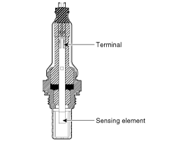

# Sensor de oxigênio (HO2S) — descrição e operação

[Home](../../index.md) / [Manual de Serviço e Reparo](../sportage-482.md) / [Motorização NU](index.md) / Sensor de oxigênio (HO2S) — descrição e operação

## Descrição

Sensor de Oxigênio Quente (HO2S) é composto por zircônio e alumina
e está instalado tanto antes quanto depois do Conversor Catalítico. Varia de acordo com a proporção ar/fuel.

O sensor deve estar quente para operar normalmente. Para manter
ele quente, o sensor tem um aquecedor controlado pelo ECM através de um sinal de ciclo de duty cycle. Quando a temperatura do gases de escape é inferior ao valor especificado, o aquecedor aquece o cabo do sensor.

