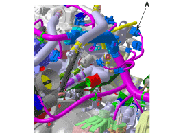
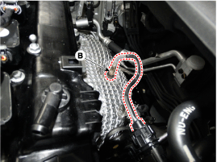
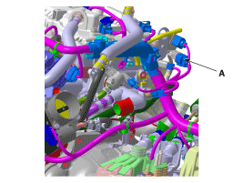
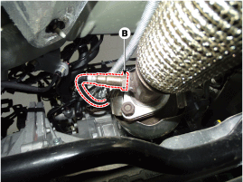

# Sensor de oxigênio (HO2S) — procedimentos

[Home](../../index.md) / [Manual de Serviço e Reparo](../sportage-482.md) / [Motorização NU](index.md) / Sensor de oxigênio (HO2S) — procedimentos

## Inspeção

1. Desligue o interruptor de ignição.

2. Desconecte o conector do sensor de oxigênio quente (HO2S).

3. Medir a resistência entre os terminais 2 e 5 [B1/S1] do sensor de oxigênio quente.

   Medir a resistência entre os terminais 3 e 4 [B1/S2] do sensor de oxigênio quente.

4. Verifique se a resistência está dentro da especificação.

   ```
   Especificação : Consulte a "Especificação"
   ```

## Remoção

1. Desligue o interruptor de ignição e desconecte o cabo negativo (-) da bateria.

2. Desconecte o conector (A) e, em seguida, remova o sensor (B).

   > **Nota**
   >
   > - O SST (Part No.: 09392-2H100) é útil na remoção do sensor de oxigênio quente.

   [Banco 1 / Sensor 1]

   

   

   [Banco 1 / Sensor 2]

   

   

## Instalação

> **Cautela**
>
> - Instale o componente com as torques especificadas.
> - Tenha em mente que danos internos podem ocorrer se o componente for solto. Neste caso, use-o após a inspeção.

> **Cautela**
>
> - NÃO use limpa-oxidadores, sprays ou graxas no elemento de detecção e no conector do sensor, pois componentes de óleo neles podem afetar o desempenho do sensor.
> - O sensor e suas conexões podem ser danificados em caso de contato com o sistema de escape (Manifold de escape, Conversor Catalítico, etc.).

1. A instalação é o inverso da remoção.

   ```
   Instalação do sensor de oxigênio quente :
   39,2 ~ 49,1 N.m (4,0 ~ 5,0 kgf.m, 28,9 ~ 36,2 lb-ft)
   ```
