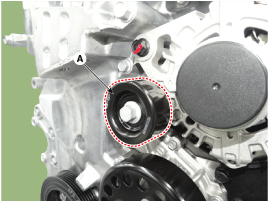

# Kia Sportage SL: Motorização NU / Idler Repair procedures

[Home](../../index.md) / [Kia Sportage SL Service & Repair Manual](../sportage-482.md) / [Motorização NU](index.md) / Idler Repair procedures

## Remoção e Instalação

1. Remova a corrente dentada.

   (Consulte o Sistema de Alineação - "Corrente Dentada")

2. Remova o rolamento (A).

   ```
   Torque de aperto :
   39,2 ~ 49,0N.m (4,0 ~ 5,0kgf.m, 28,9 ~ 36,2lb-ft)
   ```

   

3. Instale na ordem inversa à remoção.

## Inspeção

Verifique o rolamento para verificar a vazamento excessivo de óleo, rotação anormal ou vibração. Substitua se necessário.
