# Sistema de ignição

[Home](../../index.md) / [Manual de Serviço e Reparo](../sportage-482.md) / [Motorização NU](index.md) / Sistema de ignição

## Descrição e Operação

## Descrição

O ajuste do tempo de ignição é controlado pelo sistema de ignição com controle eletrônico.

Os dados de referência padrão de ajuste do tempo de ignição para as condições de operação do motor estão pré-programados na memória do ECU (Module de Controle do Motor).

As condições de operação do motor (velocidade, carga, aquecimento, etc.) são detectadas pelos diversos sensores. Com base nessas sinais de sensor e nos dados de ajuste do tempo de ignição, sinais para interromper a corrente primária são enviados ao ECU.

O bobinado de ignição é ativado, e o ajuste do tempo é controlado.

## Procedimentos de Reparo

## Inspeção no Veículo

Inspeção do conjunto do bobinado de ignição e teste de chama

1. Verifique os códigos de diagnóstico (DTCs).

   > **Nota**
   >
   > - Se um DTC estiver presente, realize o procedimento de diagnóstico correspondente a esse DTC. (Consulte o guia de códigos de diagnóstico)

2. Verifique se ocorrem chamas.

   (1) Remova a capa do motor.

   (2) Remova os bobinados de ignição.

   (3) Usando uma chave de chama de bobina, remova as chamas de ignição.

   (4) Desconecte as conexões de extensão dos injetores.

   (5) Terceirize a chama de ignição ao motor.

    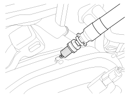

   (6) Verifique se ocorrem chamas em cada chama de ignição enquanto o motor estiver sendo girado.

   > **Nota**
   >
   > - Não gire o motor por mais de 5 segundos.

3. Se as chamas não ocorrerem, realize o seguinte teste.

   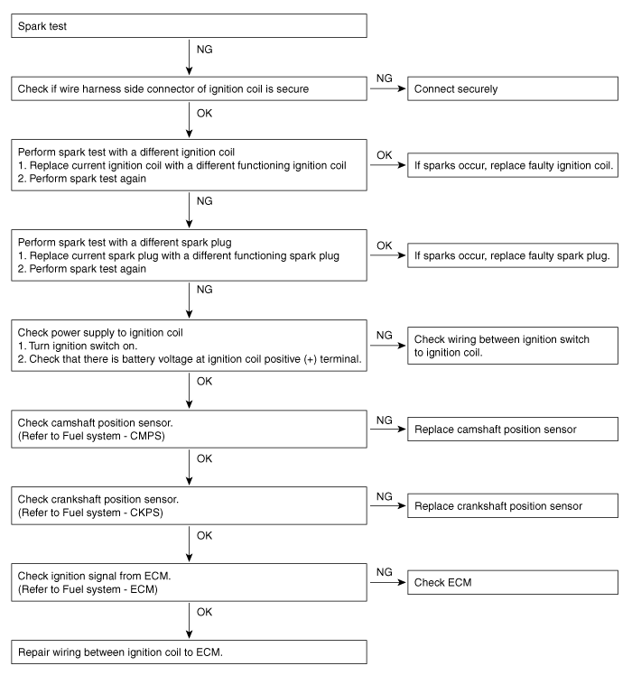

4. Usando uma chave de chama de bobina, instale as chamas de ignição.

5. Instale os bobinados de ignição.

6. Instale a capa do motor.

## Descrição e Operação do Bobinado de Ignição

## Descrição

Um bobinado de ignição é um transformador de indução no sistema de ignição do motor que transforma a tensão baixa da bateria em uma tensão alta necessária para criar um facho elétrico nas chamas de ignição para iniciar a combustão do combustível. Os bobinados têm um resistor interno, enquanto outros dependem de um resistor de fio ou de um resistor externo para limitar a corrente que flui do suprimento de 12 V da bateria para o bobinado.

## Especificações do Bobinado de Ignição

## Especificação

| Item | Especificação |
| --- | --- |
| Resistência do Bobinado Primário (?) | 0,61 ± 15% [20°C (68°F)] |
| Resistência do Bobinado Secundário (k?) | 7,5 ± 15% [20°C (68°F)] |

## Diagrama Schematico do Bobinado de Ignição

## Diagrama de Circuito

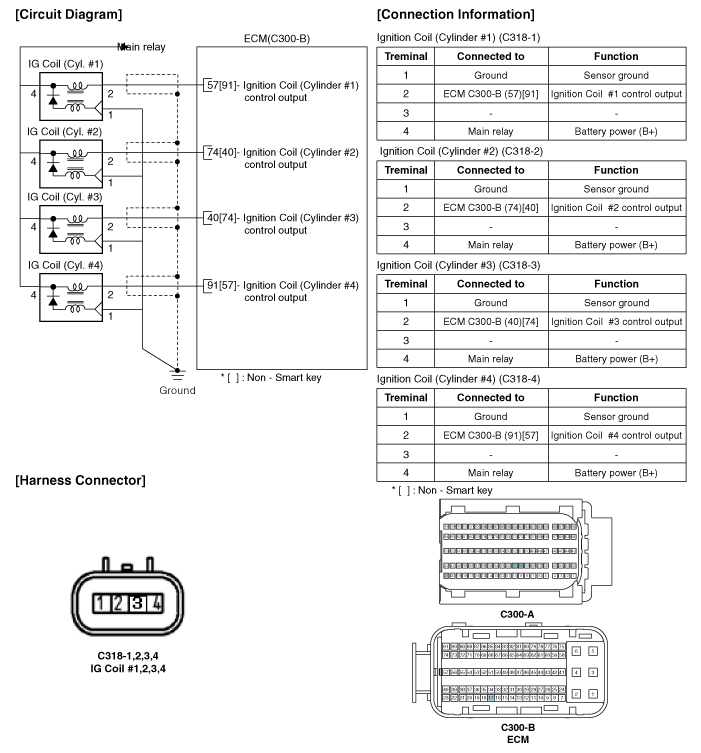

## Procedimentos de Reparo do Bobinado de Ignição

## Remoção

1. Desligue o interruptor de ignição e desconecte o cabo negativo (-) da bateria.

2. Remova a capa do motor.

3. Desconecte a conexão do bobinado de ignição (A).

   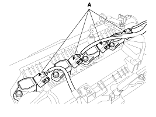

   > **Nota**
   >
   > - Ao remover a conexão do bobinado de ignição, puxe o pincolet (A) e empurre o gatilho (B).

4. Remova o bobinado de ignição (A).

   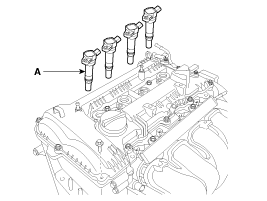

## Instalação

1. Instale na ordem inversa à remoção.

   ```
   Parafusos de instalação do bobinado de ignição:
   9,8 ~ 11,8 N.m (1,0 ~ 1,2 kgf.m, 7,2 ~ 8,7 lb-ft)
   ```

## Inspeção

1. Medir a resistência do bobinado primário entre os terminais 1 e 2.

   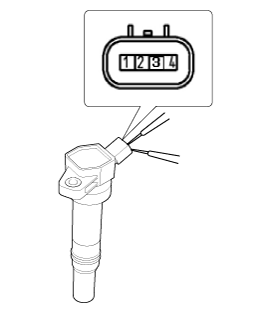

   ```
   Valor padrão: 0,61 ? ± 15%
   ```

## Descrição e Operação do Filtro de Chama

## Descrição

Um filtro de chama é um dispositivo para fornecer corrente elétrica de um sistema de ignição para o câmbio de combustão de um motor a ignição por chama, para iniciar a mistura de combustível/aria comprimida nele através de um sopro elétrico, mantendo a pressão de combustão dentro do motor. Um filtro de chama tem uma concha de metal com rosca, isolada eletricamente de um eletrodo central por um isolador de cerâmica de porcelana.

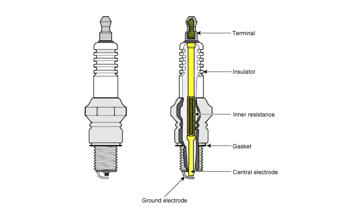

## Especificações do Filtro de Chama

## Especificação

| Item | Especificação |
| --- | --- |
| Tipo | ELR9IQP9+ |
| Intervalo de intervalo | 0,8 ~ 0,9 mm (0,0314 ~ 0,0354 in.) |

## Procedimentos de Reparo do Filtro de Chama

## Inspeção

[Inspeção no veículo]

1. Acelere o motor até cerca de 3.000 rpm 3 vezes ou mais.

2. Remova o filtro de chama.

3. Verifique visualmente o filtro de chama.

   Se o eletrodo estiver seco, o filtro de chama está normal.

   Se o eletrodo estiver úmido, verifique o dano e o intervalo do eletrodo conforme abaixo.

[Inspeção do Componente]

1. Verifique o filtro de chama para qualquer dano em sua rosca e isolador.

   Se houver dano, substitua o filtro de chama.

2. Verifique o eletrodo. Medir a resistência de isolamento com um ohmímetro.

   Se a resistência for menor que o valor especificado, ajuste o intervalo do eletrodo.

   ```
   Especificação: 10 M? ou mais
   ```

   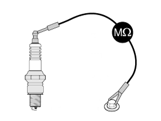

3. Verifique o intervalo do eletrodo do filtro de chama.

   Se o intervalo for maior que o máximo, substitua o filtro de chama.

   ```
   Especificação: 0,8 ~ 0,9 mm (0,0314 ~ 0,0354 in.)
   ```

   > **Nota**
   >
   > - Ao ajustar o intervalo de um novo filtro de chama, curva apenas a base do eletrodo de base. Não toque no cabo.
   > - Nunca tente ajustar o intervalo em um plugue usado.

   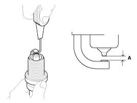

## Limpeza

A combustão fica temporariamente instável devido ao combustível envelhecido e aos depósitos de carbono acumulados nas pinhas de ignição após o armazenamento a longo prazo.

[1ª Método]

1. Inicie o motor e mantenha-o em idle por 2 minutos.

2. Pressione o pedal do acelerador e mantenha-o firme em 4500 rpm com o engrenamento em posição N para aquecer o motor até que a temperatura do líquido de resfriamento atinja 80°C.

3. Mantenha o motor em 2500~3000 rpm com o engrenamento em posição N por 15 minutos.

   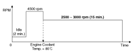

[2ª Método]

> **Nota**
>
> - Este método deve ser realizado apenas se o 1º método falhar (os códigos relacionados à falha do acelerador retornarem).

1. Inicie o motor e mantenha-o em idle por 2 minutos.

2. Dirija o veículo por mais de 20 minutos, mantendo a velocidade do motor acima de 3500 rpm.

   > **Nota**
   >
   > - Se equipado com transmissão manual, altere a marcha corretamente para manter a velocidade do motor acima de 3500 rpm.

   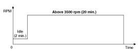

## Remoção

1. Remova o coímbulo de ignição.

   (Consulte o Sistema de Ignição - "Coímbulo de Ignição")

2. Usando uma chave de pinha de ignição, remova a pinha de ignição (A).

   > **Nota**
   >
   > - Cuide para que nenhuma contaminação entre nas fendas das pinhas de ignição.

   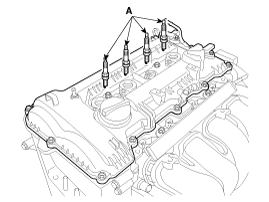

## Instalação

1. Instale na ordem inversa da remoção.

   ```
   Torque de aperto:
   14,7 ~ 24,5 N.m (1,5 ~ 2,5 kgf.m, 10,9 ~ 18,0 lb-ft)
   ```
