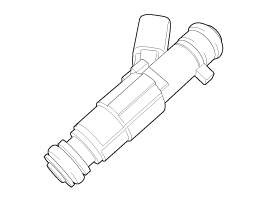

# Kia Sportage SL: Motorização NU / Injector Description and Operation

[Home](../../index.md) / [Kia Sportage SL Service & Repair Manual](../sportage-482.md) / [Motorização NU](index.md) / Injector Description and Operation

## Descrição

Com base nas informações fornecidas por vários sensores, o ECM pode calcular a quantidade de combustível a ser injetada. O injetor é um valveo operado por solenoide e a quantidade de injeção de combustível é controlada pelo tempo de duração da injeção. O ECM controla cada injetor ao conectar o circuito de controle. Quando o ECM energiza o injetor conectando o circuito de controle, a tensão do circuito deve ser baixa (teoricamente 0V) e o combustível é injetado. Quando o ECM desenergiza o injetor abrindo o circuito de controle, o injetor é fechado e a tensão do circuito deve picar momentaneamente.

