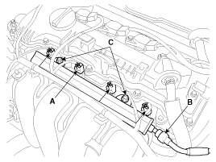
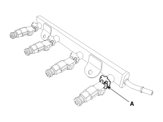

# Injetor — procedimentos

[Home](../../index.md) / [Manual de Serviço e Reparo](../sportage-482.md) / [Motorização NU](index.md) / Injetor — procedimentos

## Inspeção

1. Desligue o interruptor de ignição.

2. Desconecte o conector do injetor.

3. Mede a resistência entre os terminais 1 e 2 do injetor.

4. Verifique se a resistência está dentro da especificação.

   ```
   Especificação : Consulte a "Especificação"
   ```

## Remoção

1. Desligue o interruptor de ignição e desconecte o cabo negativo (-) da bateria.

2. Libere a pressão residual na linha de combustível.

   (Consulte "Liberação da Pressão Residual na Linha de Combustível" neste grupo).

   > **Cuidado**
   >
   > - Ao remover o relé do bomba de combustível, um Código de Falha Diagnóstico (DTC) pode ocorrer. Exclua o código com o GDS após a conclusão do trabalho de "Liberação da Pressão Residual na Linha de Combustível".

3. Desconecte o conector do injetor (A).

4. Desconecte o quick-connector da tubulação de alimentação de combustível (B).

5. Remova a viga de alimentação e o injetor, desmontando a viga de alimentação e o injetor da viga de alimentação.

   

6. Remova o clip de fixação (A), e, em seguida, separe o injetor da viga de alimentação.

   

## Instalação

> **Cuidado**
>
> - Instale o componente com as torques especificadas.
> - Tenha em mente que danos internos podem ocorrer se o componente cair. Neste caso, utilize-o após a inspeção.

> **Cuidado**
>
> - Aplicar óleo de motor no anel do injetor.

> **Cuidado**
>
> - Inspeção do anel do injetor ao instalar.

1. A instalação é o inverso da remoção.

   ```
   Torque da viga de alimentação de instalação :
   18,6 ~ 23,5 N.m (1,9 ~ 2,4 kgf.m, 13,7 ~ 17,4 lb-ft)
   ```
