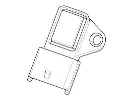

# Kia Sportage SL: Motorização NU / Intake Air Temperature Sensor (IATS) Description and Operation

[Home](../../index.md) / [Kia Sportage SL Service & Repair Manual](../sportage-482.md) / [Motorização NU](index.md) / Intake Air Temperature Sensor (IATS) Description and Operation

## Descrição

O Sensor de Temperatura do Ar Introduzido (IATS) está incluído no Sensor de Pressão do Manifold Absoluto (MAPS) e detecta a temperatura do ar introduzido.

Para calcular a quantidade de ar precisa, é necessário corrigir a temperatura do ar porque a densidade do ar varia de acordo com a temperatura. Então, o ECM usa não apenas o sinal do MAPS, mas também o sinal do IATS. Este sensor tem um Termistor de Coeficiente Negativo de Temperatura (NTC) e sua resistência varia na proporção inversa à temperatura.

