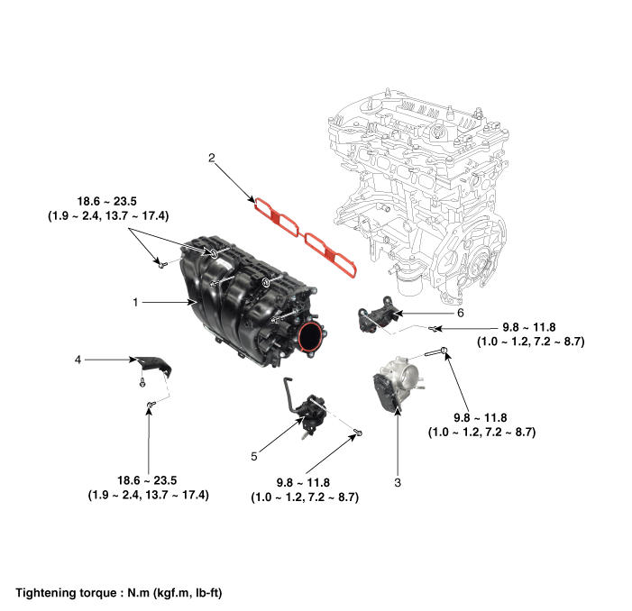

# Coletor de admissão — componentes e localização

[Home](../../index.md) / [Manual de Serviço e Reparo](../sportage-482.md) / [Motorização NU](index.md) / Coletor de admissão — componentes e localização

## Componentes

| 1. Montagem do manifold de admissão 2. Gasket do manifold de admissão 3. Corpo do acelerador eletrônico | 4. Manifold de admissão de apoio 5. Atuador do solenoide de admissão variável (VIS) 6. Motor VCM |
| --- | --- |
