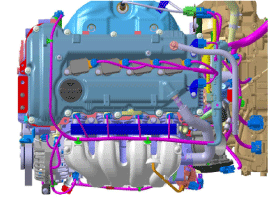
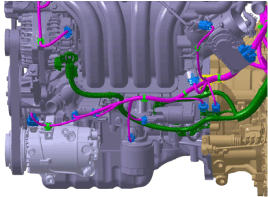
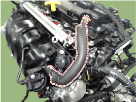
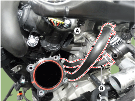
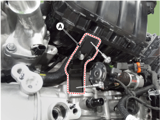
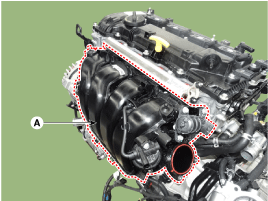
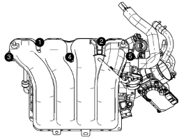

# Kia Sportage SL: Motorização NU / Intake Manifold Repair procedures

[Home](../../index.md) / [Kia Sportage SL Service & Repair Manual](../sportage-482.md) / [Motorização NU](index.md) / Intake Manifold Repair procedures

## Remoção e Instalação

1. Remova a capa do motor.

   (Consulte Montagem do Motor e Caixa de Transmissão - "Capa do Motor")

2. Desconecte o terminal negativo da bateria.

3. Remova a mangueira e a assembléia do limpador de ar.

   (Consulte Sistema de Admissão e Exaustão - "Limpador de Ar")

4. Remova a cobertura inferior do motor.

   (Consulte Montagem do Motor e Caixa de Transmissão - "Cobertura Inferior do Motor")

5. Desconecte os conectores de alimentação e os engates dos cabos de proteção da mangueira de admissão.

   

   

6. Desconecte a mangueira de ventilação primária do câmara de combustão (PCV) (A).

   

7. Desloque os parafusos do módulo do controle do corpo de termostato elétrico (ETC) (A).

   (Consulte Sistema de Controle do Motor/Combustível - "Sistema ETC (Controle do corpo de termostato elétrico)")

8. Desconecte a mangueira de vácuo (A) e a mangueira do solenoide de controle de purga (PCSV) (B).

   

9. Remova o suporte do manifold de admissão (A).

   ```
   Torque de aperto :
   18,6 ~ 23,5N.m (1,9 ~ 2,4kgf.m, 13,7 ~ 17,4lb-ft)
   ```

   

10. Remova o manifold de admissão (A) com a borracha de vedação.

    ```
    Torque de aperto :
    18,6 ~ 23,5N.m (1,9 ~ 2,4kgf.m, 13,7 ~ 17,4lb-ft)
    ```

    

    > **Nota**
    >
    > - Ao instalar o manifold de admissão, aperte os parafusos e
    >  os parafusos de pre-aperto primeiro, e depois aperte-os com
    >  o torque especificado na sequência mostrada.

    

11. Instale na ordem inversa da remoção.
