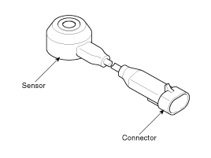

# Kia Sportage SL: Motorização NU / Knock Sensor (KS) Description and Operation

[Home](../../index.md) / [Kia Sportage SL Service & Repair Manual](../sportage-482.md) / [Motorização NU](index.md) / Knock Sensor (KS) Description and Operation

## Descrição

Chacoalhamento é um fenômeno caracterizado por vibrações e ruídos indesejáveis e pode causar danos ao motor. O Sensor de Chacoalho (KS) é instalado no bloco do cilindro e detecta chacoalhamento no motor.

Quando ocorre chacoalhamento, a vibração do bloco do cilindro é aplicada como pressão ao elemento piezoeletrico. Quando ocorre um chacoalhamento, o sensor produz um sinal de tensão. O ECM atrasa o acionamento da ignição quando ocorre chacoalhamento. Se o chacoalhamento desaparecer após o atraso do acionamento da ignição, o ECM avançará o acionamento da ignição. Este controle sequencial pode melhorar a potência, torque e economia de combustível do motor.

