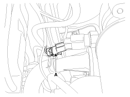
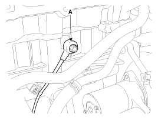

# Kia Sportage SL: Motorização NU / Knock Sensor (KS) Repair procedures

[Home](../../index.md) / [Kia Sportage SL Service & Repair Manual](../sportage-482.md) / [Motorização NU](index.md) / Knock Sensor (KS) Repair procedures

## Remoção

1. Desligue a chave do ignição e desconecte o cabo negativo (-) da bateria.

2. Desconecte o conector do sensor de martelada (A).

   

3. Remova o manifold de admissão.

   (Consulte o Sistema Mecânico do Motor - "Manifold de Admissão")

4. Remova a viga de fixação (A), e então remova o sensor do bloco do cilindro.

   

## Instalação

> **Cuidado**
>
> - Instale o componente com as torques especificadas.
> - Tenha em mente que danos internos podem ocorrer se o componente for solto. Neste caso, use após inspeção.

1. A instalação é o contrário da remoção.

   ```
   Torque do parafuso de instalação do sensor de martelada :
   18,6 ~ 23,5 N.m (1,9 ~ 2,4 kgf.m, 13,7 ~ 17,4 lb-ft)
   ```
