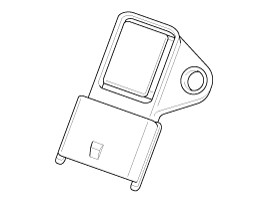

# Sensor MAPS (pressão absoluta do coletor) — descrição e operação

[Home](../../index.md) / [Manual de Serviço do Kia Sportage NU](index.md) / [Sistema de Controle e Sistema de Combustível](nu-engine_control_fuel_system-3018.md) / [Sistema de Controle do Motor](nu-engine_control_system-3023.md) / Sensor MAPS (pressão absoluta do coletor) — descrição e operação

## Descrição

O Sensor de Pressão Absoluta do Manifold (MAPS) é um sensor de tipo velocidade-densidade e está instalado no tanque de surto. Ele detecta a pressão absoluta do tanque de surto e transfere o sinal analógico proporcional à pressão para o ECM. Usando esse sinal, o ECM calcula a quantidade de ar de admissão e a velocidade do motor.

O MAPS consiste em um elemento piezoelétrico e uma IC híbrida que amplifica a saída do elemento. O elemento é do tipo diâfragma de silício e adapta o efeito de resistor variável sensível à pressão do semi-condutor. Como 100% de vácuo e a pressão do manifolds são aplicados, respectivamente, a ambos os lados do sensor, este sensor pode emitir um sinal analógico usando a variação de silício proporcional ao mudança de pressão.

