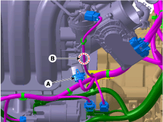

# Kia Sportage SL: Motorização NU / Manifold Absolute Pressure Sensor (MAPS) Repair procedures

[Home](../../index.md) / [Kia Sportage SL Service & Repair Manual](../sportage-482.md) / [Motorização NU](index.md) / Manifold Absolute Pressure Sensor (MAPS) Repair procedures

## Inspeção

1. Conecte o GDS no Conector de Linha de Dados (DLC).

2. Medida da tensão de saída do MAPS em idle e IG ON.

   | Condição | Tensão de Saída (V) |
   | --- | --- |
   | IG ON | 3,9 ~ 4,1 |
   | Idle | 0,8 ~ 1,6 |

## Remoção

1. Desligue o interruptor de ignição e desconecte o cabo negativo (-) da bateria.

2. Desconecte o conectador do sensor de pressão do manifold absoluto (A).

3. Remova a viga de fixação (B), e, em seguida, remova o sensor do tanque de sobrecarga.

   

## Instalação

> **Cuidado**
>
> - Instale o componente com as torques especificadas.
> - Tenha em mente que danos internos podem ocorrer se o componente for solto. Neste caso, utilize após a inspeção.

> **Cuidado**
>
> - Insira o sensor na vaga de instalação e tenha cuidado para não danificar durante a instalação.

1. A instalação é o inverso da remoção.

   ```
   Tensão do parafuso de instalação do sensor de pressão do manifold absoluto:
   9,8 ~ 11,8 N.m (1,0 ~ 1,2 kgf.m, 7,2 ~ 8,7 lb-ft)
   ```
