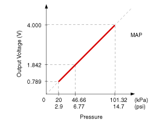

# Sensor MAPS (pressão absoluta do coletor) — especificações

[Home](../../index.md) / [Manual de Serviço e Reparo](../sportage-482.md) / [Motorização NU](index.md) / Sensor MAPS (pressão absoluta do coletor) — especificações

## Especificação

| Pressão [kPa (kgf/cm?, psi)] | Vítreo de Saída (V) |
| --- | --- |
| 20,0 (0,20, 2,9) | 0,79 |
| 46,7 (0,47, 6,77) | 1,84 |
| 101,3 (1,03, 14,7) | 4,0 |

