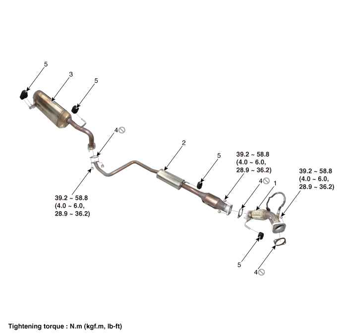

# Silencioso — componentes e localização

[Home](../../index.md) / [Manual de Serviço e Reparo](../sportage-482.md) / [Motorização NU](index.md) / Silencioso — componentes e localização

## Componentes

| 1. Silencioso Dianteiro 2. Conversor Catalítico & Montagem Do Silencioso Central | 3. Silencioso Principal 4. Gasket 5. Aro de Suspensão |
| --- | --- |
