# Kia Sportage SL: Motorização NU / Muffler Repair procedures

[Home](../../index.md) / [Kia Sportage SL Service & Repair Manual](../sportage-482.md) / [Motorização NU](index.md) / Muffler Repair procedures

## Remoção e Instalação

Mufflete Frente

1. Desconecte o terminal negativo da bateria.

2. Desconecte o conectador do sensor de oxigênio (A).

   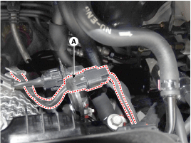

3. Desconecte o amarrilho de borracha (A) do mufflete frente.

4. Remova o mufflete frente (B).

   ```
   Torque de aperto :
   39,2 ~ 58,8 N.m (4,0 ~ 6,0 kgf.m, 28,9 ~ 43,4 lb-ft)
   ```

   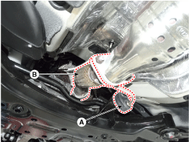

   > **Nota**
   >
   > - Ao instalar, substitua as borrachas de vedação.

5. Instale na ordem inversa da remoção.

Mufflete Central

1. Desconecte o amarrilho de borracha (A) do mufflete central.

2. Remova o catalisador e o mufflete central (B).

   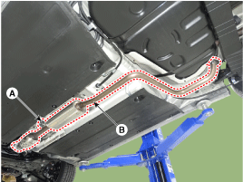

   > **Nota**
   >
   > - Ao instalar, substitua as borrachas de vedação.

3. Instale na ordem inversa da remoção.

Mufflete Principal

1. Desconecte os amarrilhos de borracha (A) do mufflete principal.

2. Remova o mufflete principal (B).

   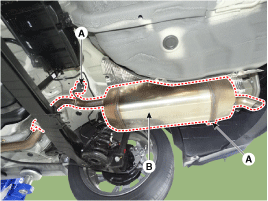

   > **Nota**
   >
   > - Ao instalar, substitua as borrachas de vedação.

3. Instale na ordem inversa da remoção.

Procedimento de substituição do mufflete central usando cinto

Dentro da garantia : Substitua a montagem do mufflete central.

Fora da garantia : É possível substituir o mufflete central conforme o procedimento abaixo.

1. Verifique se a parte do cinto do mufflete central está danificada ou deformada.

   Se o mufflete estiver muito corrosivo para ser cinto, substitua a montagem do mufflete central.

   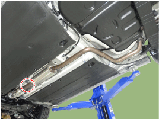

2. Registre a distância (A, B, C, D, E, F) entre a tubulação (ou capa de tubulação) e o para-choque traseiro.

   [Tipo de tubulação]

   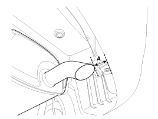

   [Tipo de capa de tubulação]

   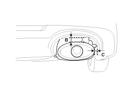

   [Tipo de capa de tubulação integrada no para-choque]

   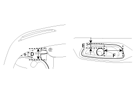

3. Remova o catalisador e o mufflete central (A).

   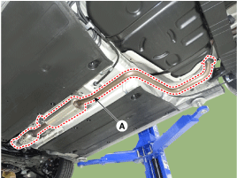

4. Corte o mufflete central conforme as instruções abaixo.

   [Com dobra]

   A. Corte a dobra frontal do mufflete.

   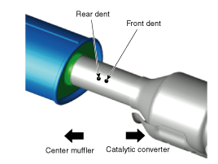

   [Sem dobra]

   A. Corte o mufflete referindo-se à dobra frontal do mufflete A/S conforme a imagem abaixo.

   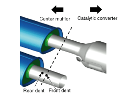

   [Mufflete A/S]

   A. Corte a dobra traseira do mufflete A/S.

   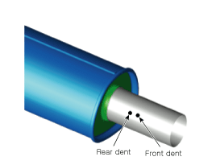

   > **Nota**
   >
   > - Para prevenir vazamentos, remova a corrosão na parte do cinto ou a ferrugem na parte do corte.
   > - Corte a tubulação verticalmente.

   | • Utilize um cortador de tubulação para cortar a tubulação verticalmente. • Se não houver um cortador de tubulação, use uma segadora conforme o procedimento abaixo. 1. Marque a posição de corte para cortar a tubulação verticalmente. 2. Corte a tubulação ao longo da linha de marcação usando uma segadora. | |

| --- | --- |
| • | Cortador de tubos disponível para cortar o tubo verticalmente. |
| • | Use uma sega se um cortador de tubos não estiver disponível. |
| 1. | Marque a posição de corte para cortar o tubo verticalmente. |
| 2. | Corte o tubo ao longo da linha de marcação usando uma sega. |

5. Instale o silencioso central.

   (1) Instale o catalisador (A) e o silencioso central (B) para A/S, apertando os parafusos levemente, não completamente.

    

    > **Nota**
    >
    > - Ao instalar o silencioso, substitua a borracha com uma nova.

   (2) Coloque o cabo (A) entre a parte de corte de cada tubo e aperte o cabo levemente, não completamente.

    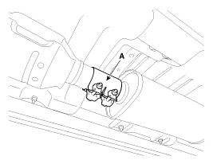

   (3) Ajuste o catalisador e o silencioso central com a torção especificada.

    ```
    Torção de aperto:
    39,2~58,8 N.m (4,0 ~ 6,0 kgf.m, 28,9~43,4 lb-ft)
    ```

   (4) Compare a distância entre a tubulação final (ou capa final) e o para-choque traseiro com a medida registrada antes de remover a montagem do silencioso central.

    > **Nota**
    >
    > - Se a tubulação final estiver instalada de forma diferente em relação à
    posição inicial, o para-choque pode ser danificado pelo calor do tubo ou
    intervir entre a tubulação final e o para-choque traseiro.

   (5) Não aperte o cabo de uma vez. Ajuste os parafusos do cabo até a torção especificada, alternadamente.

    ```
    Torção de aperto:
    17,6~23,5 N.m (1,8 ~ 2,4 kgf.m, 13,0~17,4 lb-ft)
    ```

    

    > **Nota**
    >
    > - Não reutilize o cabo que foi apertado completamente. Pode causar vazamento reutilizar o cabo que foi apertado completamente.
