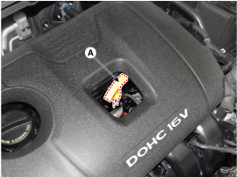

# Vareta e tubo de nível do óleo — procedimentos

[Home](../../index.md) / [Manual de Serviço e Reparo](../sportage-482.md) / [Motorização NU](index.md) / Vareta e tubo de nível do óleo — procedimentos

## Remoção e Instalação

1. Remova o indicador do nível do óleo (A).

   

2. Instale na ordem inversa à remoção.
