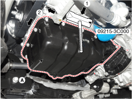
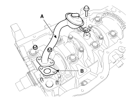
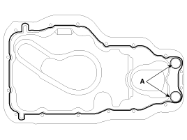
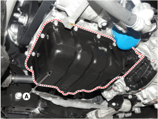

# Cárter — procedimentos

[Home](../../index.md) / [Manual de Serviço e Reparo](../sportage-482.md) / [Motorização NU](index.md) / Cárter — procedimentos

## Remoção

1. Remova o cobertor inferior do motor.

   (Consulte o Montagem do Motor e da Transmissão - "Cobertor Inferior do Motor")

2. Derrame o óleo do motor.

   (Consulte o Sistema de Lubrificação - "Óleo do Motor")

3. Remova a garrafa de óleo (A).

   (1) Desafinque os parafusos.

   (2) Insira a lâmina do SST (09215-3C000) entre a caixa inferior do motor e a garrafa de óleo. Separe o selante aplicado e remova a garrafa de óleo.

    

   > **Nota**
   >
   > - Desafinque um parafuso da garrafa de óleo perto de cada canto da garrafa, deixando os parafusos presos por cerca de 2 fios. Em seguida, remova todos os outros parafusos da garrafa de óleo.

   > **Nota**
   >
   > - Insira o SST entre a garrafa de óleo e a caixa inferior do motor, batendo suavemente com um martelo de plástico na direção do setor. Depois de batido com o martelo de plástico na direção do setor em mais de 2/3 da borda da garrafa de óleo, remova-o da caixa inferior do motor.
   > - Não vire o SST bruscamente sem batê-lo. Isso resultará em danos ao SST.
   > - Cuide para não danificar as superfícies de contato da caixa inferior do motor e da garrafa de óleo.

4. Remova a grade de filtragem de óleo (A) com o selo (B).

    

## Instalação

1. Instale a grade de óleo (A) com um novo selante (B).

   ```
   Torque de aperto
   Parafuso :
   19,6 ~ 26,5 N.m (2,0 ~ 2,7 kgf.m, 14,5 ~ 19,5 lb-ft)
   Parafuso :
   11,8 ~ 13,7 N.m (1,2 ~ 1,4 kgf.m, 8,7 ~ 10,1 lb-ft)
   ```

   

2. Instale a caixa de óleo.

   (1) Usando um raspador de selante, remova todo o material antigo de preenchimento das superfícies do selante.

   (2) As áreas de selante na caixa de óleo e na parte inferior do câmbio devem estar livres de materiais estranhos prejudiciais, óleo, poeira e umidade.

    Spray um limpa-para-limpar na superfície e limpe com um pano limpo.

   (3) Após aplicar selante líquido na caixa de óleo, monte-a dentro de 5 minutos após a aplicação do selante. Um contorno de selante contínuo deve ser aplicado para prevenir qualquer caminho de vazamento de óleo.

    ```
    Largura do contorno
    Seção inteira : 4,0 ~ 5,0 mm (0,16 ~ 0,20 polegadas)
    Seção A : 1,5 ~ 2,5 mm (0,06 ~ 0,10 polegadas)
    Selante: Threebond 1217H (RTV Hyundai Cinza)
    ```

    

    > **Nota**
    >
    > - Quando aplicar selante em um selante, o selante não deve projetar-se para dentro da caixa de óleo.
    > - Se o selante for aplicado à superfície inferior do câmbio inferior, deve estar na mesma posição da caixa de óleo.

   (4) Instale a caixa de óleo (A). Ajuste uniformemente os parafusos em várias passadas.

    ```
    Torque de aperto:
    11,8 ~ 13,7 N.m (1,2 ~ 1,4 kgf.m, 8,7 ~ 10,1 lb-ft)
    ```

    

    > **Nota**
    >
    > - Após a montagem, aguarde pelo menos 30 minutos antes de encher o motor com óleo.

    > **Nota**
    >
    > - Sempre use um novo selante do bocal de drenagem.

3. Refilhe o motor com óleo de motor.
