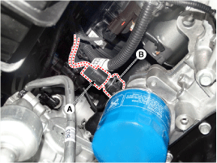
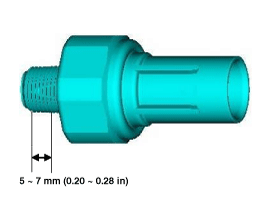
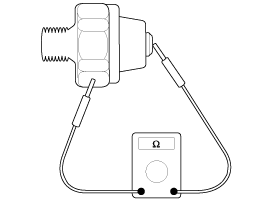
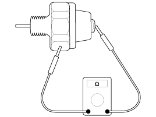

# Interruptor de pressão do óleo — procedimentos

[Home](../../index.md) / [Manual de Serviço e Reparo](../sportage-482.md) / [Motorização NU](index.md) / Interruptor de pressão do óleo — procedimentos

## Remoção e Instalação

1. Desconecte o conector do interruptor de pressão de óleo (A) e, em seguida, remova o interruptor de pressão de óleo (B).

   ```
   Torque de aperto :
   9,8 ~ 11,8 N.m (1,0 ~ 1,2 kgf.m, 7,2 ~ 8,7 lb-ft)
   ```

   

2. Instale na ordem inversa à remoção.

> **Nota**
>
> - Ao instalar o interruptor de pressão de óleo, aplique o selante à thread.

```
Selante : THREEBOND 2403
Espessura : 0,2 ~ 0,4 mm (0,008 ~ 0,016 polegadas)
```



## Inspeção

1. Verifique a continuidade entre o terminal e a massa com um ohmímetro.

   Se não houver continuidade, substitua o interruptor de pressão de óleo.

   

2. Verifique a continuidade entre o terminal e a massa quando o fio fino for pressionado. Se houver continuidade mesmo quando o fio fino for pressionado, substitua o interruptor.

3. Se não houver continuidade quando uma pressão de 50 kPa (0,50 kgf/cm?, 7,25 psi) for aplicada através do orifício do óleo, o interruptor está operando corretamente.

   Verifique a presença de vazamento de ar. Se houver vazamento de ar, o diáfino está quebrado. Substitua-o.

   
