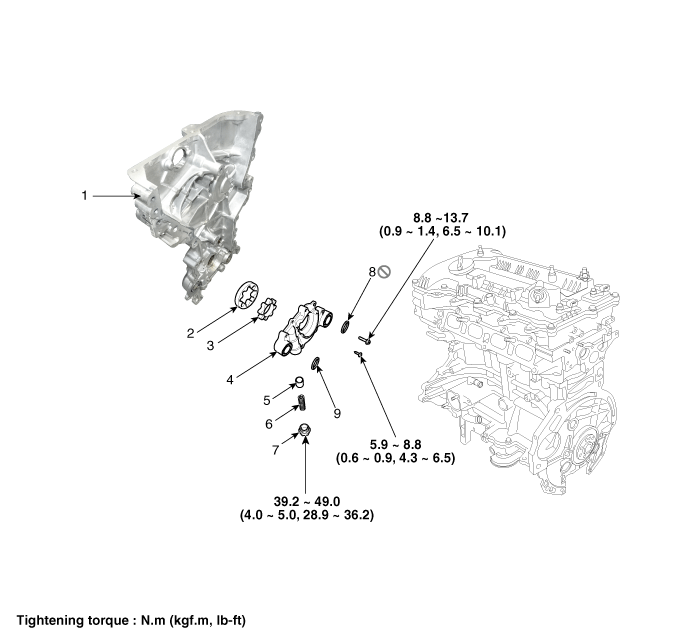

# Kia Sportage SL: Motorização NU / Oil Pump Components and Components Location

[Home](../../index.md) / [Kia Sportage SL Service & Repair Manual](../sportage-482.md) / [Motorização NU](index.md) / Oil Pump Components and Components Location

## Componentes

| 1. Cobertura da Corrente de Atempo 2. Rotaor Externo 3. Rotaor Interno 4. Cobertura da Bomba de Óleo 5. Plunger de Alívio | 6. Mola de Alívio 7. Plugs de Alívio 8. Aro de Selagem (Lado de Suction) 9. Aro de Selagem (Lado de Discharge) |
| --- | --- |
