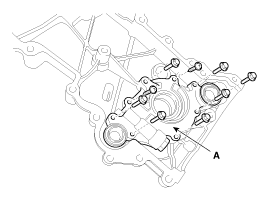
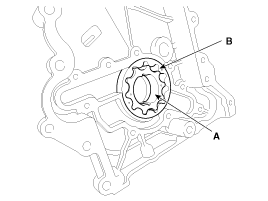
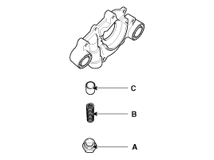
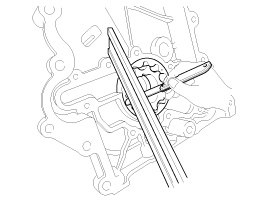
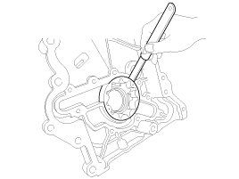
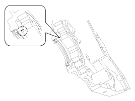

# Bomba de óleo — procedimentos

[Home](../../index.md) / [Manual de Serviço e Reparo](../sportage-482.md) / [Motorização NU](index.md) / Bomba de óleo — procedimentos

## Remoção e Instalação

1. Remova a cobertura da corrente de sincronização.

   (Consulte o Sistema de Sincronização – "Cobertura da Corrente de Sincronização")

2. Remova a cobertura da bomba de óleo (A).

   ```
   Torque de aperto
   Parafusos :
   5,9 ~ 8,8 N.m (0,6 ~ 0,9 kgf.m, 4,3 ~ 6,5 lb-ft)
   Parafusos :
   8,8 ~ 13,7 N.m (0,9 ~ 1,4 kgf.m, 6,5 ~ 10,1 lb-ft)
   ```

   

3. Remova o rotor interno (A) e o rotor externo (B).

   

4. Instale na ordem inversa à remoção.

## Inspeção

1. Remova o plunger de alívio.

   Remova o plug (A), a mola (B) e o plunger de alívio (C).

   ```
   Torque de aperto
   Plug (A) :
   39,2 ~ 49,0 N.m (4,0 ~ 5,0 kgf.m, 28,9 ~ 36,2 lb-ft)
   ```

   

2. Inspeção do plunger de alívio.

   Passe óleo de motor no plunger e verifique se ele cai facilmente no orifício do plunger por sua própria gravidade.

   Se necessário, substitua a cobertura da corrente de sincronização.

3. Inspeção da mola do valvulino de alívio.

   Verifique a distorção ou falha da mola do valvulino de alívio.

4. Inspeção da clearance lateral dos rotores.

   Usando um régua de passagem e um guia retilíneo preciso, mede a clearance lateral entre os rotores internos e o guia retilíneo preciso.

   Se a clearance lateral for maior que o máximo, substitua os rotores como um conjunto.

   Se necessário, substitua a cobertura da corrente de sincronização.

   ```
   Clearance lateral:
   0,040 ~ 0,090 mm (0,00157 ~ 0,00354 in.)
   ```

   

5. Inspeção da clearance do corpo dos rotores.

   Usando uma régua de passagem, mede a clearance entre o rotor externo e o corpo.

   Se a clearance do corpo for maior que o máximo, substitua os rotores como um conjunto.

   Se necessário, substitua a cobertura da corrente de sincronização.

   ```
   Clearance do corpo:
   0,200 ~ 0,292 mm (0,00787 ~ 0,01150 in.)
   ```

   

6. Inspeção da clearance do guia dos rotores.

   (1) Mede o diâmetro externo do guia do rotor interno.

    ```
    Diâmetro do rotor interno:
    41,550 ~ 41,570 mm (1,63582 ~ 1,63661 in.)
    ```

   (2) Mede o diâmetro interno do orifício da cobertura da corrente de sincronização.

    ```
    Diâmetro interno do orifício da cobertura da corrente de sincronização:
    41,600 ~ 41,625 mm (1,63779 ~ 1,63878 in.)
    ```

   (3) Verifique a clearance entre o diâmetro interno do orifício da cobertura da corrente de sincronização e o diâmetro externo do guia do rotor interno.

    

   ```
   Clearance do guia:
   0,030 ~ 0,075 mm (0,00118 ~ 0,00295 in.)
   ```
