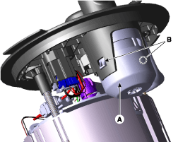
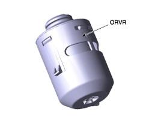

# Kia Sportage SL: Motorização NU / On-board Refueling Vapor Recovery (ORVR) valve Repair procedures

[Início](../../index.md) / [Manual de Serviço do Kia Sportage NU](index.md) / [Sistema de Controle de Emissão](nu-emission_control_system-2994.md) / [Sistema de Controle de Emissão Evaporativa](nu-evaporative_emission_control_system-3006.md) / Procedimentos de Reparo da Valvula de Recuperação de Vapores durante Abastecimento (ORVR)

## Remoção

1. Desligue o interruptor do acionamento da ignição, e então remova o cabo do bateriapositivo (-).

2. Remova a bomba de combustível.

   (Consulte o Sistema de Combustível - "Bomba de Combustível")

3. Remova a valvula ORVR (A) após soltar as ganchos (B).

   

   

## Instalação

1. A instalação é o inverso da remoção.
