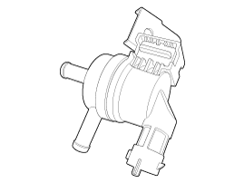

# Válvula PCSV (controle de purga) — descrição e operação

[Home](../../index.md) / [Manual de Serviço e Reparo](../sportage-482.md) / [Motorização NU](index.md) / Válvula PCSV (controle de purga) — descrição e operação

## Descrição

A Valvula de Solenoide de Controle de Purga (PCSV) está instalada no
manifold de admissão e controla a purga evaporação entre o canister e o manifold de admissão. É uma valvula de solenoide normalmente fechada e está aberta quando o ECM (Controle de Entrada de Combustível) chama o controle da linha da valvula. Quando a passagem está aberta (PCSV ON), o vapor de combustível armazenado no canister é transferido para o manifold de admissão.

