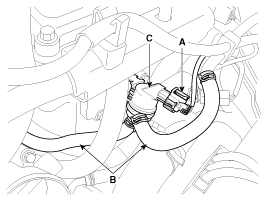

# Kia Sportage SL: Motorização NU / Purge Control Solenoid Valve (PCSV) Repair procedures

[Home](../../index.md) / [Kia Sportage SL Service & Repair Manual](../sportage-482.md) / [Motorização NU](index.md) / Purge Control Solenoid Valve (PCSV) Repair procedures

## Inspeção

1. Desligue o interruptor de ignição.

2. Desconecte o conector da PCSV.

3. Mede a resistência entre os terminais 1 e 2 da PCSV.

4. Verifique que a resistência esteja dentro da especificação.

   ```
   Especificação : Consulte "Especificação"
   ```

## Remoção

1. Desligue o interruptor de ignição e desconecte o cabo negativo (-) da bateria.

2. Desconecte o conector da valvula de solenoide de controle de purga (A).

3. Desconecte as mangueiras de vapor (B) da valvula de solenoide de controle de purga.

4. Remova a valvula (C) do tanque de surto após puxá-la.

   

## Instalação

> **Cuidado**
>
> - Instale o componente com as torques especificadas.
> - Tenha cuidado para que a queda do componente não cause danos internos. Neste caso, utilize-o após a inspeção.

> **Cuidado**
>
> - Tenha cuidado para evitar a entrada de material estranho na valvula.

1. A instalação é o inverso da remoção.

   ```
   Parafuso de montagem do suporte da valvula de solenoide de controle de purga :
   9,8 ~ 11,8 N.m (1,0 ~ 1,2 kgf.m, 7,2 ~ 8,7 lb-ft)
   ```
