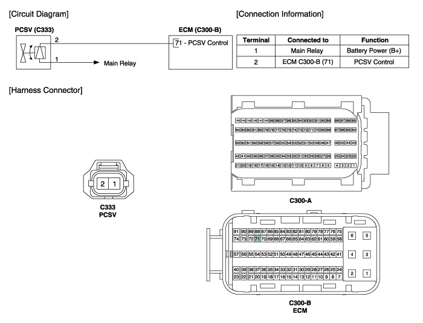

# Kia Sportage SL: Motorização NU / Purge Control Solenoid Valve (PCSV) Schematic Diagrams

[Home](../../index.md) / [Kia Sportage SL Service & Repair Manual](../sportage-482.md) / [Motorização NU](index.md) / Purge Control Solenoid Valve (PCSV) Schematic Diagrams

## Diagrama Elétrico

