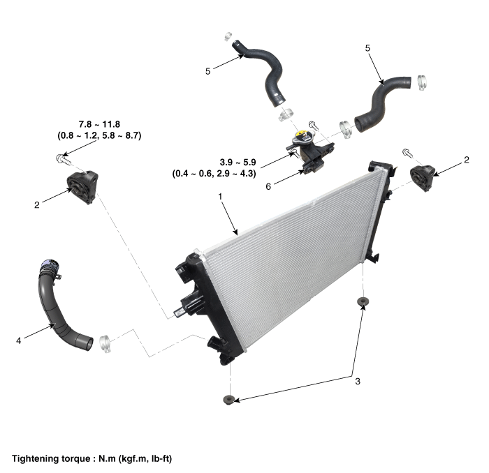

# Radiador — componentes e localização

[Home](../../index.md) / [Manual de Serviço e Reparo](../sportage-482.md) / [Motorização NU](index.md) / Radiador — componentes e localização

## Componentes

| 1. Montagem do radiador 2. Aro de fixação superior do radiador 3. Isolador de montagem | 4. Conector rápido do bocal inferior do radiador 5. Bocal superior do radiador 6. Montagem do tanque de admissão |
| --- | --- |
