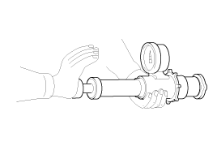
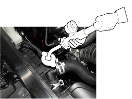
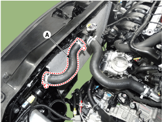
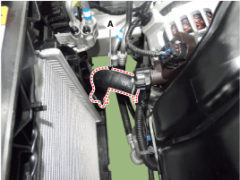
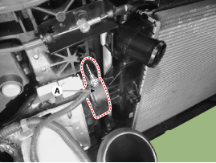
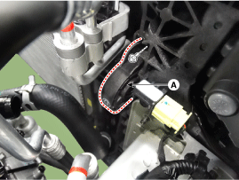
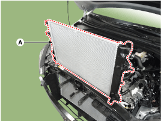

# Radiador — procedimentos

[Home](../../index.md) / [Manual de Serviço e Reparo](../sportage-482.md) / [Motorização NU](index.md) / Radiador — procedimentos

## Inspeção

Teste da Capa do Radiador

1. Remova a capa do radiador, molhe sua junta com líquido antifreeze do motor e, em seguida, instale-a em um teste de pressão.

   

2. Aplique uma pressão de 93,16 ~ 122,58 kPa (0,95 ~ 1,25 kgf/cm?, 13,51 ~ 17,78 psi).

3. Verifique se houve uma queda na pressão.

4. Se a pressão diminuir, substitua a capa.

Teste de Vazamento do Radiador

1. Aguarde que o motor esfrie, depois remova cuidadosamente a capa do radiador e preencha o radiador com líquido antifreeze do motor, instale-o no teste de pressão.

2. Aplique um teste de pressão ao radiador e aplique uma pressão de 93,16 ~ 122,58 kPa (0,95 ~ 1,25 kgf/cm?, 13,51 ~ 17,78 psi).

   

3. Inspeção para vazamentos de líquido antifreeze do motor e queda na pressão.

4. Remova o teste de pressão e reinstale a capa do radiador.

   > **Nota**
   >
   > - Verifique por óleo do motor no líquido antifreeze e/ou líquido antifreeze no óleo do motor.

## Remoção e Instalação

1. Despeje o líquido antifreeze.

   (Consulte o Sistema de Refrigeração - "Líquido Antifreeze")

2. Remova o ventilador de resfriamento.

   (Consulte o Sistema de Refrigeração - "Ventilador de Resfriamento")

3. Remova o gancho de montagem superior do radiador (A).

   

4. Remova a conexão rápida do gancho inferior do radiador (A).

   

   > **Nota**
   >
   > - Quando a mangueira foi desmontada, remova o gancho (A) e, em seguida, desconecte a conexão rápida.

5. Remova o capô frontal.

   (Consulte o Corpo - "Capô Frontal")

6. Remova os ganhos de montagem superior do radiador (A).

   ```
   Torque de aperto :
   7,8 ~ 11,8 N.m (0,8 ~ 1,2 kgf.m, 5,8 ~ 8,7 lb-ft)
   ```

   [LH]

   

   [RH]

   

7. Remova o resonador.

   (Consulte o Sistema de Admissão e Exaustão - "Cleaner do Ar")

8. Remova o condensador do ar condicionado da montagem do radiador.

9. Remova a montagem do radiador (A) do veículo.

   

10. Instale na ordem inversa da remoção.

11. Preencha o radiador com líquido antifreeze e verifique vazamentos.

   (Consulte o Sistema de Refrigeração - "Líquido Antifreeze")

   > **Nota**
   >
   > - Descubra o ar do sistema de resfriamento.
   > - (Consulte o Sistema de Refrigeração - "Líquido Antifreeze")
