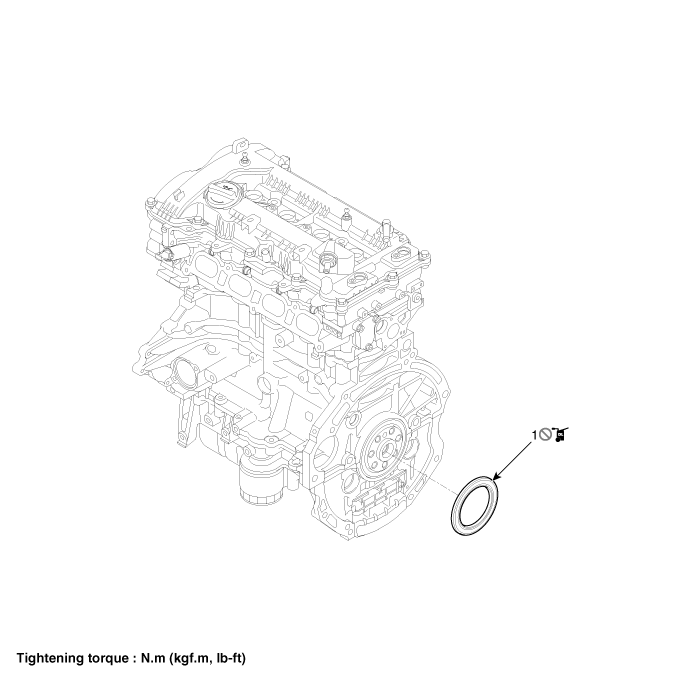

# Retentor traseiro — componentes e localização

[Home](../../index.md) / [Manual de Serviço e Reparo](../sportage-482.md) / [Motorização NU](index.md) / Retentor traseiro — componentes e localização

## Componentes

1. Circumferência de óleo traseira
