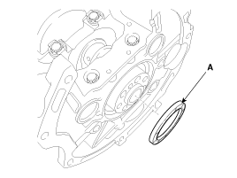
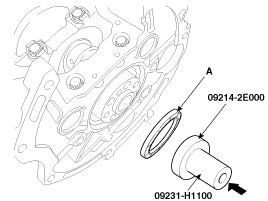

# Retentor traseiro — procedimentos

[Home](../../index.md) / [Manual de Serviço e Reparo](../sportage-482.md) / [Motorização NU](index.md) / Retentor traseiro — procedimentos

## Remoção

1. Remova a transmissão automática.

   (Consulte o Sistema de Transmissão Automática - "Transmissão Automática")

2. Remova a placa de transmissão.

   (Consulte o Cilindro – "Placa de Transmissão")

3. Remova a selante do fundo (A).

   

## Instalação

1. Instale uma nova selante do fundo.

   (1) Aplicar óleo do motor na borda da nova selante.

   (2) Usando SST (09231-H1100, 09214-2E000) e um martelo, bata a selante (A) até que o face do SST esteja alinhado com a face de trás da montagem do bloco do cilindro.

    

2. Instale as outras peças na ordem inversa da remoção.
