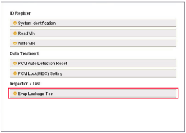
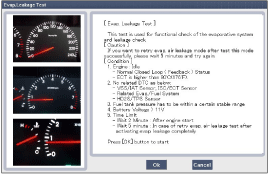
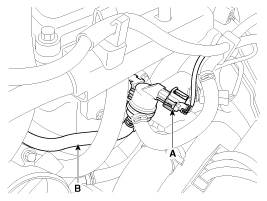

# Procedimentos

[Home](../../index.md) / [Manual de Serviço e Reparo](../sportage-482.md) / [Motorização NU](index.md) / Procedimentos

## Inspeção

### TESTE DE PERDA EVAP.

1. Selecione "Teste de Perda Evap.".

   

2. Realize o teste de acordo com as introduções na tela.

   

### INSPEÇÃO PCSV

1. Desligue o interruptor de ignição e desconecte o cabo negativo (-) da bateria.

2. Desconecte o conectador PCSV (A).

3. Desconecte a mangueira de vapor (B) que está conectada ao manifold de admissão do PCSV.

   

4. Após conectar um pump de vácuo ao bocal, aplique vácuo.

5. Com a linha de controle do PCSV conectada ao solo, verifique a operação do
   válvula com a tensão da bateria aplicada ao PCSV (Aberta) e removida (Fechada).

   | Tensão da Bateria | Válvula | Vácuo |
   | --- | --- | --- |
   | Conectada | Aberta | Liberado |
   | Desconectada | Fechada | Mantido |

6. Mede a resistência do bobino do PCSV.

   ```
   Especificações :
   22,0 ~ 26,0 ? [20°C(68°F)]
   ```
