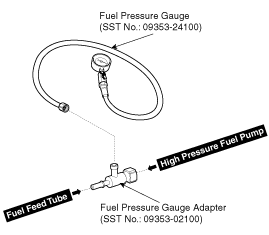
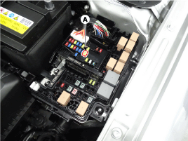

# Kia Sportage SL: Motorização NU / Repair procedures

[Home](../../index.md) / [Kia Sportage SL Service & Repair Manual](../sportage-482.md) / [Motorização NU](index.md) / Repair procedures

## Test de Pressão do Combustível

1. Libere a pressão residual na linha de combustível.

   (Consulte o Sistema de Suprimento de Combustível - "Libere a Pressão Residual na Linha de Combustível")

   > **Cuidado**
   >
   > - Ao remover o fusível do bomba de combustível, um Código de Falha Diagnóstico (CFD) pode ocorrer. Exclua o código com o GDS após a conclusão do trabalho de "Liberação da Pressão Residual na Linha de Combustível".

2. Instale a Ferramenta Especial de Serviço (FES).

   (1) Desconecte a tubulação de alimentação de combustível da tubulação de suprimento.

    > **Cuidado**
    >
    > - Mesmo após o trabalho de "Liberação da Pressão Residual na Linha de Combustível", pode haver pressão residual, então cubra a conexão do tubo com uma toalha de oficina para prevenir a derramamento de combustível antes de desconectar qualquer conexão de combustível.

   (2) Instale a ferramenta especial de medição de pressão do combustível entre a tubulação de alimentação de combustível e a tubulação de suprimento (Consulte a figura abaixo).

    

3. Inspeção de vazamento de combustível nas conexões entre a tubulação de alimentação de combustível, a tubulação de suprimento e os componentes da FES com o IG ON.

4. Medida da Pressão do Combustível.

   (1) Inicie o motor e mede a pressão do combustível em idle.

    ```
    Pressão do Combustível :
    355 ~ 365 kPa (3,4 ~ 3,7 kgf/cm?, 48,6 ~ 52,9 psi)
    ```

    > **Nota**
    >
    > - Se a pressão do combustível diferir do valor padrão, conserte ou substitua a parte relacionada (Consulte a tabela abaixo).

    | Pressão do Combustível | Causa | Parte Relacionada |
    | --- | --- | --- |
    | Baixa | Filtragem do combustível entupida | Filtro de Combustível |
    | Vazamento de combustível | Regulador de Pressão do Combustível | |
    | Alta | Válvula do regulador de pressão do combustível travada | Regulador de Pressão do Combustível |

   (2) Pare o motor e, em seguida, verifique a mudança na leitura do indicador de pressão do combustível.

    ```
    Valor Padrão: A leitura do indicador deve se manter por cerca de 5 minutos após a parada do motor
    ```

    > **Nota**
    >
    > - Se a leitura do indicador não se manter, conserte ou substitua a parte relacionada (Consulte a tabela abaixo).

    | Pressão do Combustível (Depois de Parar o Motor) | Causa | Parte Relacionada |
    | --- | --- | --- |
    | A Pressão do Combustível Decresce Lentamente | Vazamento no injetor | Injetor |
    | A Pressão do Combustível Decresce Imediatamente | Válvula de verificação da bomba de combustível travada aberta | Bomba de Combustível |

   (3) Desligue a chave do ignição.

5. Libere a pressão residual na linha de combustível.

   (Consulte o Sistema de Suprimento de Combustível - "Liberação da Pressão Residual na Linha de Combustível")

   > **Cuidado**
   >
   > - Ao remover o fusível do bomba de combustível, um Código de Falha Diagnóstico (CFD) pode ocorrer. Exclua o código com o GDS após a conclusão do trabalho de "Liberação da Pressão Residual na Linha de Combustível".

6. Fim do Teste

   (1) Remova a Ferramenta Especial de Serviço (FES) da tubulação de alimentação de combustível e da tubulação de suprimento.

   (2) Conecte a tubulação de alimentação de combustível e a tubulação de suprimento.

## Liberar a Pressão Residual na Linha de Combustível

> **Cuidado**
>
> - Mesmo após a realização do "Liberar a Pressão Residual na Linha de Combustível", pode haver ainda alguma pressão residual, então cubra a conexão do mangote com um lenço de oficina para prevenir a derramamento de combustível antes de desconectar qualquer conexão de combustível.

1. Desligue o interruptor de ignição e desconecte o cabo do bocal (-) da bateria.

2. Remova o fusível do bomba de combustível (A).

   

3. Conecte o cabo do bocal (-) da bateria.

4. Inicie o motor e deixe-o em idle, e depois desligue o interruptor de ignição após o motor parar por conta própria.
