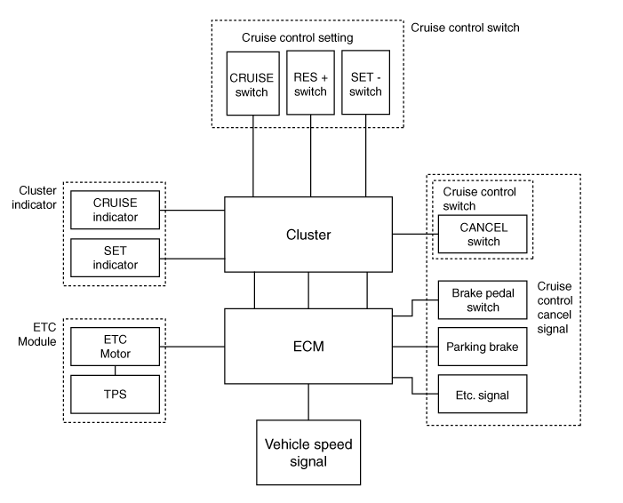

# Kia Sportage SL: Motorização NU / Schematic Diagrams

[Home](../../index.md) / [Kia Sportage SL Service & Repair Manual](../sportage-482.md) / [Motorização NU](index.md) / Schematic Diagrams

## Diagrama de Bloco do Sistema

Detalhamento das Partes do Componente e Funções

| Parte do Componente | Função |  |
| --- | --- | --- |
| Sensor de Velocidade do Veículo, Módulo de Controle ESP/ABS | Converte a velocidade do veículo em pulsos. |  |
| ECM | Recebe sinais do sensor e dos interruptores de controle. |  |
| Indicador de Cruzeirismo | Ilumina quando o interruptor principal CRUISE estiver ON (Integrado no cluster) |  |
| Interruptores de Cruzeirismo | Interruptor CRUISE | Interruptor para alimentação do controle de velocidade automático. |
| Interruptor RES+ | Controla as funções de resumo/acceleração do controle de velocidade automático (Interruptor Set/Coast) |  |
| Interruptor SET- |  |  |
| Interruptores Cancelar | Interruptor Cancelar | Envia sinais de cancelamento para o ECM. |
| Interruptor do Pedal do Freio |  |  |
| Interruptor do Mecanismo do Câmbio Transaxial (AT) |  |  |
| Motor ETC | Regula o valvulário do acelerador para a abertura estabelecida pelo ECM. |  |

* Motor ETC : Motor de Controle de Acelerador Eletrônico
