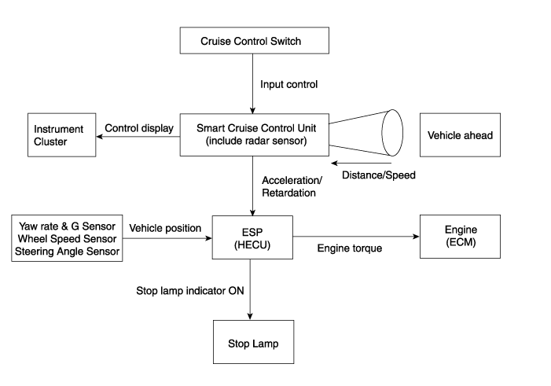

# Diagramas esquemáticos

[Home](../../index.md) / [Manual de Serviço e Reparo](../sportage-482.md) / [Motorização NU](index.md) / Diagramas esquemáticos

## Gráficos de Sintomas de Falha

Especificação e Função dos Componentes

| Componente | Função |
| --- | --- |
| Interruptor de Controle de Cruzeiro | Entrada da velocidade e distância definidas para o ECU SCC. |
| Painel de Instrumentos | Exibição de diversas informações enviadas pelo SCC. |
| Unidade de Controle de Cruzeiro Inteligente | Reconhecimento e rastreamento do veículo à frente. Cálculo da velocidade e distância alvo Solicitação de aceleração e freio ao ESP |
| VDC (HECU) | Freio automático e solicitação do controle da torção do motor ao ECU do Motor (ECM) Solicitação do controle de torção do EPB ao Freio de Estacionamento Elétrico (EPB) Solicitação do indicador de luz de parada ON |
| Motor (ECM) | Controle da torção do motor |
| Luz de Parada | Indicador de luz de parada ON |
