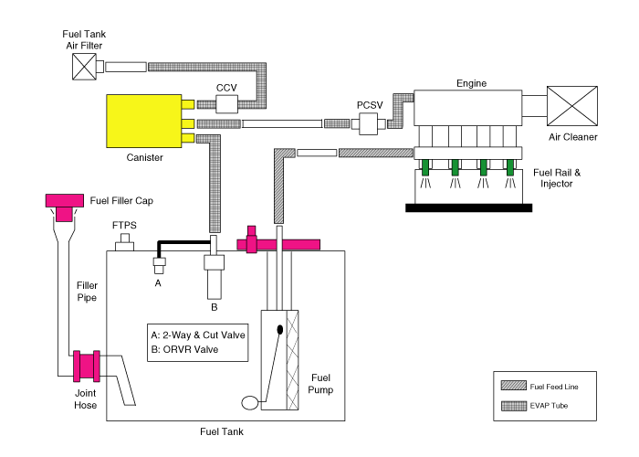

# Diagramas esquemáticos

[Home](../../index.md) / [Manual de Serviço e Reparo](../sportage-482.md) / [Motorização NU](index.md) / Diagramas esquemáticos

## Diagrama Esquemático

Cânister

O Cânister é preenchido com carvão e absorve vapores de combustível evaporados do tanque de combustível. Os vapores de combustível coletados no cânister são sugados para o manifold de admissão pelo ECM/PCM quando as condições apropriadas são estabelecidas.

Valvula de Controle de Purga (PCSV)

A Valvula de Controle de Purga (PCSV) está instalada no canal que conecta o cânister ao manifold de admissão. É uma válvula solenoide de serviço e é operada por sinal do ECM/PCM.

Para sugar os vapores absorvidos para o manifold de admissão, o ECM/PCM abrirá a PCSV, caso contrário, o canal permanecerá fechado.

Copo de Enchimento de Combustível

Um dispositivo de aperto com engrenagem no copo de enchimento de combustível reduz as chances de instalação incorreta, ao selar o copo de enchimento. Após o selo do copo de enchimento e a flange do bocal de enchimento entrarem em contato, o dispositivo de engrenagem produz um clique alto indicando que o selo foi estabelecido.

Sensor de Pressão do Tanque de Combustível (FTPS)

O Sensor de Pressão do Tanque de Combustível (FTPS) é uma parte integral do sistema de monitoramento. O FTPS verifica a operação da Valvula de Controle de Purga (PCSV) e furos no Sistema de Controle de Emissões Evaporativas monitorando a pressão e o nível de vácuo no tanque de combustível durante os ciclos de operação da PCSV.

Valvula de Fechamento do Cânister (CCV)

A Valvula de Fechamento do Cânister (CCV) está localizada entre o cânister e o filtro de ar do tanque de combustível. Ela fecha a entrada de ar para o cânister do Sistema de Emissões Evaporativas e também previne a escapada de vapores de combustível do Cânister quando o veículo não está em operação.

Monitoramento do Sistema Evaporativo

O Sistema de Monitoramento de Controle de Emissões Evaporativas monitora a geração de vapores de combustível, a evacuação e um passo de verificação de vazamento. Primeiro, o sistema OBD-II verifica se a geração de vapores devido à temperatura do combustível é pequena o suficiente para iniciar o monitoramento. Em seguida, evacua o sistema evaporativo através da PCSV com rampa para manter um certo nível de vácuo. O último passo é verificar se há perda de vácuo devido a qualquer vazamento no sistema.

Verificação da Geração de Vapores

Durante o período de estabilização, a PCSV e o CCV estão fechados. A pressão do sistema é medida como pressão inicial (DP_A). Após um período definido (T1), a pressão do sistema (DP_B) é medida novamente e a diferença em relação à pressão inicial é calculada. Se essa diferença (DP_B - DP_A) for maior que o limiar, deve haver uma pressão de vapores excessiva e o monitoramento será interrompido para a próxima verificação. Caso contrário, se a diferença for menor que o limiar negativo, a PCSV será considerada como malfuncionando, como obstruída no estado aberto.

Detecção de Vazamento Grande no Sistema Evaporativo

A PCSV é aberta com uma certa rampa para que a pressão chegue a um certo nível. Se a pressão não puder ser reduzida abaixo de um limiar, o sistema será considerado como tendo um copo de combustível aberto ou um grande vazamento.

Verificação de Vazamento

A PCSV é fechada e o sistema aguarda um período para obter

pressão estabilizada. Durante o período de verificação (T2), o sistema mede
o início e o fim da pressão do sistema (DP_C, DP_D). O valor de diagnóstico
é a diferença de pressão corrigida pela taxa de geração natural de vapor
(DP_B - DP_A) do passo de verificação da geração de vapor.
