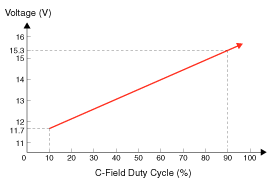

# Especificações

[Home](../../index.md) / [Manual de Serviço e Reparo](../sportage-482.md) / [Motorização NU](index.md) / Especificações

## Especificação

Sistema de Ignição

Bobina de Ignição

| Item | Especificação |
| --- | --- |
| Resistência do Coil Primário (?) | 0,61 ± 15% [20°C (68°F)] |
| Resistência do Coil Secundário (k?) | 7,5 ± 15% [20°C (68°F)] |

Interruptor de Fogo

| Item | Especificação |
| --- | --- |
| Tipo | ELR9IQP9+ |
| Espaçamento | 0,8 ~ 0,9 mm (0,0314 ~ 0,0354 in.) |

Sistema de Carregamento

Gerador

| Item | Especificação |  |
| --- | --- | --- |
| Tensão nominal | 13,5V, 150A |  |
| Velocidade de uso | 1.000 ~ 18.000 rpm |  |
| Regulador de Tensão | Tipo de Regulador Interno IC |  |
| Configuração de Tensão do Regulador | Modo Externo | Consulte o gráfico abaixo |
| Modo Interno | 14,55 ± 0,3V |  |
| Gradiente de Temperatura | Modo Externo | 0 ± 3 mV / °C |
| Modo Interno | -3,5 ± 2mV / °C |  |

Bateria

?AGM60L-DIN

| Item | Especificação |
| --- | --- |
| Tipo de Modelo | AGM60L-DIN |
| Capacidade [20HR/5HR] (AH) | 60/48 |
| Corrente de Arranque em Temperatura Baixa (A) | 640 (SAE) / 512(EN) |
| Capacidade de Reserva (Min) | 100 |

| • Descrição do Tipo de Modelo • Corrente de Arranque em Temperatura Baixa (CCA): A Corrente de Arranque em Temperatura Baixa é uma classificação utilizada na indústria de baterias para definir a capacidade de uma bateria de iniciar um motor em temperaturas baixas. - A classificação é o número de amperes que uma nova e completamente carregada bateria pode fornecer a -18 °C (-0,4 °F) por 30 segundos, mantendo uma tensão de pelo menos 7,2 volts para uma bateria de 12 volts. - O maior o rating de CCA, maior o poder de partida da bateria. • CAPACIDADE DE RESERVA (RC) : A Capacidade de Reserva é uma classificação da indústria de baterias, definindo a capacidade de uma bateria de alimentar um veículo com um alternador ou correia de ventilador inoperante. - A classificação é o número de minutos que uma bateria a 26,7 °C (80 °F) pode ser descarregada a 25 amperes e manter uma tensão de 10,5 volts para uma bateria de 12 volts. - O maior o rating de reserva, maior o tempo que seu veículo pode operar se seu alternador ou correia de ventilador falhar. |  |
| --- | --- |
| • | Descrição do Tipo de Modelo |
| • | Corrente de Arranque em Temperatura Baixa (CCA): A Corrente de Arranque em Temperatura Baixa é uma classificação utilizada na indústria de baterias para definir a capacidade de uma bateria de iniciar um motor em temperaturas baixas. |
| - | A classificação é o número de amperes que uma nova e completamente carregada bateria pode fornecer a -18 °C (-0,4 °F) por 30 segundos, mantendo uma tensão de pelo menos 7,2 volts para uma bateria de 12 volts. |
| - | O maior o rating de CCA, maior o poder de partida da bateria. |
| • | CAPACIDADE DE RESERVA (RC) : A Capacidade de Reserva é uma classificação da indústria de baterias, definindo a capacidade de uma bateria de alimentar um veículo com um alternador ou correia de ventilador inoperante. |
| - | A classificação é o número de minutos que uma bateria a 26,7 °C (80 °F) pode ser descarregada a 25 amperes e manter uma tensão de 10,5 volts para uma bateria de 12 volts. |
| - | O maior o rating de reserva, maior o tempo que seu veículo pode operar se seu alternador ou correia de ventilador falhar. |

Sistema de Arranque

Arranque

| Item | Especificação |  |
| --- | --- | --- |
| Tensão nominal | 12 V, 1,2 kW |  |

| O número de dentes do pinhão | 13 |  |
| Desempenho [Sem carga, 11,5 V] | Ampère | 105 A |
| Velocidade | Mín. 2.950 rpm |  |

## Torques de Aperto

| Item | N.m | kgf.m | lb-ft |
| --- | --- | --- | --- |
| Parafuso de instalação do bobinado de ignição | 9,8 ~ 11,8 | 1,0 ~ 1,2 | 7,2 ~ 8,7 |
| Parafuso de instalação da bobina de ignição | 14,7 ~ 24,5 | 1,5 ~ 2,5 | 10,9 ~ 18,1 |
| Parafuso do terminal B do cabo de alimentação do alternador | 9,8 ~ 11,8 | 1,0 ~ 1,2 | 7,2 ~ 8,7 |
| Parafuso de instalação do alternador [12 mm (0,47 in.)] | 19,6 ~ 26,5 | 2,0 ~ 2,7 | 14,5 ~ 19,5 |
| Parafuso de instalação do alternador [14 mm (0,55 in.)] | 29,4 ~ 41,2 | 3,0 ~ 4,2 | 21,7 ~ 30,4 |
| Parafuso de aperto do terminal (+) da bateria | 7,8 ~ 9,8 | 0,8 ~ 1,0 | 5,2 ~ 8,7 |
| Parafuso de aperto do terminal (-) da bateria | 3,9 ~ 5,9 | 0,4 ~ 0,6 | 2,9 ~ 4,3 |
| Parafuso de fixação do suporte da bateria | 19,6 ~ 29,4 | 2,0 ~ 3,0 | 14,5 ~ 30,4 |
| Parafuso de instalação da prateleira da bateria | 19,6 ~ 29,4 | 2,0 ~ 3,0 | 14,5 ~ 30,4 |
| Parafuso de instalação do cabo do sensor da bateria | 10,8 ~ 13,7 | 1,1 ~ 1,4 | 8,0 ~ 10,1 |
| Parafuso de instalação do motor de partida | 49,0 ~ 63,7 | 5,0 ~ 6,5 | 36,2 ~ 47,0 |
