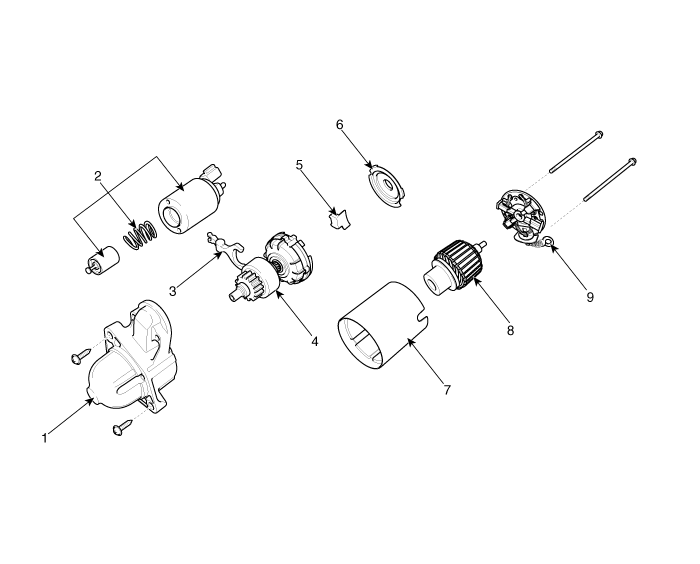

# Motor de partida — componentes e localização

[Home](../../index.md) / [Manual de Serviço do Kia Sportage NU](index.md) / [Sistema Elétrico do Motor](nu-engine_electrical_system-2934.md) / [Sistema de Início](nu-starting_system-2967.md) / Motor de partida — componentes e localização

## Componentes

| 1. Montagem do braço frontal 2. Montagem do interruptor magnético 3. Manivela 4. Montagem do reduzidor 5. Parada da manivela | 6. Folheado 7. Montagem do yoke 8. Montagem do armador 9. Montagem do suporte das escovas |
