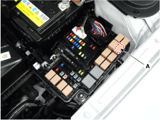
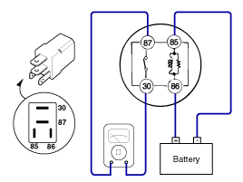

# Kia Sportage SL: Motorização NU / Starter Relay Repair procedures

[Home](../../index.md) / [Kia Sportage SL Service & Repair Manual](../sportage-482.md) / [Motorização NU](index.md) / Starter Relay Repair procedures

## Inspeção

1. Desligue o interruptor de ignição e desconecte o cabo negativo (-) da bateria.

2. Remova a tampa do painel de fusíveis.

3. Remova o relé de iniciação (A).

   

4. Usando um ohmmetro, verifique a continuidade entre cada terminal.

   | Terminal | Continuidade |
   | --- | --- |
   | 30 - 87 | NÃO |
   | 85 - 86 | SIM |

5. Aplicando 12V no terminal 85 e terra no terminal 86.

   Verifique a continuidade entre os terminais 30 e 87.

   

6. Se não houver continuidade, substitua o relé de iniciação.

7. Instale o relé de iniciação.

8. Instale a tampa do painel de fusíveis.
