# Motor de partida — procedimentos

[Home](../../index.md) / [Manual de Serviço e Reparo](../sportage-482.md) / [Motorização NU](index.md) / Motor de partida — procedimentos

## Remoção

1. Desconecte o terminal negativo da bateria.

2. Remova a tampa da bateria.

   (Consulte o Sistema Elétrico do Motor - "Bateria")

3. Remova o dutamento de ar e a montagem do filtro de ar.

   (Consulte o Sistema Mecânico do Motor - "Filtro de Ar")

4. Desconecte o cabo do iniciador (A) do terminal B do solenoide, depois desconecte o conectador do terminal S (B).

   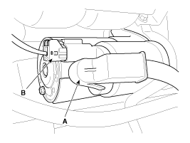

5. Remova os 2 parafusos que seguram o iniciador, depois remova o iniciador (A).

   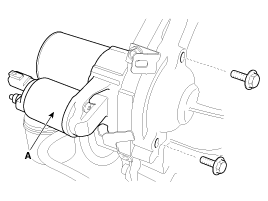

## Instalação

1. Instale na ordem inversa da remoção.

   ```
   Parafuso de instalação do iniciador :
   49,0 ~ 63,7 N.m (5,0 ~ 6,5 kgf.m, 36,2 ~ 47,0 lb-ft)
   ```

## Desmontagem

1. Desconecte o terminal M (A) na montagem do interruptor magnético.

   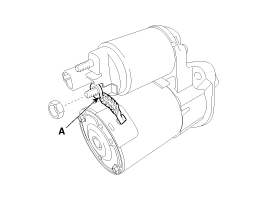

2. Depois de soltar os parafusos (A), desmonte a montagem do interruptor magnético (B).

   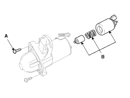

3. Solte os parafusos através (A).

   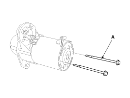

4. Remova a montagem do suporte do pincel (A), a montagem do armário (B) e a montagem do yoke (C).

   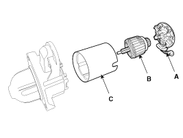

5. Remova a folha de selante (A) e o parafuso de parada (B).

   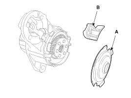

6. Remova a montagem do reduzidor (A) e o parafuso (B).

   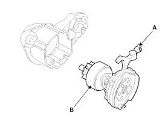

7. Com um fio de soco (B), empurre o parafuso de parada (A).

   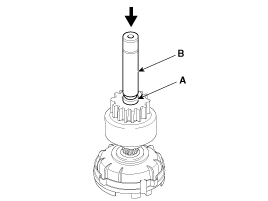

8. Depois de remover o anel de parada (A) com pinças de anel de parada (B).

   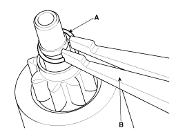

9. Desconecte o parafuso de parada (A), o clutch de rotação livre (B) e a engrenagem interna (C).

   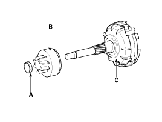

   > **Nota**
   >
   > - Usando um ferramenta de arranque apropriada (A), arraste o parafuso de parada do clutches de rotação livre (C) sobre o anel de parada (B).

10. A montagem é a ordem inversa da desmontagem.

## Montagem

1. Monte na ordem inversa da desmontagem.

## Inspeção

Inspeção do Solene do Arranque

1. Desconecte o fio de alimentação do terminal M do interruptor do solene.

2. Conecte a bateria conforme indicado. Se o pinhão do arranque sair, está funcionando corretamente.

   > **Nota**
   >
   > - Para evitar danos ao arranque, não deixe a bateria conectada por mais de 10 segundos.

   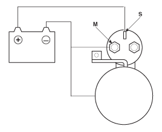

3. Desconecte a bateria do terminal M.

   Se o pinhão não se retrair, o solene de manutenção está funcionando corretamente.

   > **Nota**
   >
   > - Para evitar danos ao arranque, não deixe a bateria conectada por mais de 10 segundos.

   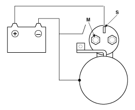

4. Desconecte a bateria também do corpo. Se o pinhão se retrair imediatamente, está funcionando corretamente.

   > **Nota**
   >
   > - Para evitar danos ao arranque, não deixe a bateria conectada por mais de 10 segundos.

   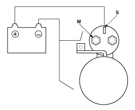

Inspeção de Funcionamento Livre

1. Coloque o motor do arranque em um vise equipado com chifres macios e conecte uma bateria carregada de 12 volts ao motor do arranque conforme indicado.

2. Conecte um amperímetro de teste (escala de 150 amperes) e resistores de carvão de acordo com a ilustração.

3. Conecte um voltmetro (escala de 15 volts) ao motor do arranque.

   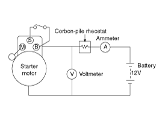

4. Vire o carvão para a posição desligada.

5. Conecte o cabo da bateria do terminal negativo da bateria ao corpo do motor do arranque.

6. Ajuste até que a tensão da bateria mostrada no voltmetro leia 11 volts.

7. Confirme que a corrente máxima está dentro das especificações e que o motor do arranque gira suavemente e livremente.

   | Corrente (Máx.) | Velocidade (Mín.) |
   | --- | --- |
   | 105 A | 2.950 rpm |

Armatura

1. Remova o arranque.

2. Desmonte o arranque conforme indicado no início deste procedimento.

3. Inspeção da armatura para desgaste ou danos devido ao contato com o magneto permanente. Se houver desgaste ou danos, substitua a armatura.

   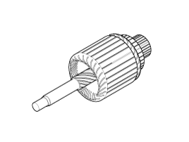

4. Verifique a superfície do comutador (A). Se a superfície estiver suja ou queimada, refaça a superfície com pano de esmeril ou lathe de acordo com as especificações a seguir, ou refaça com papel abrasivo #500 ou #600 (B).

   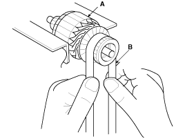

5. Verifique o diâmetro do comutador. Se o diâmetro estiver abaixo do limite de serviço, substitua a armatura.

   ```
   Diâmetro do comutador
   Padrão (Novo) : 29,4 mm (1,1575 in)
   Limite de serviço : 28,8 mm (1,1339 in)
   ```

   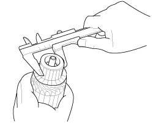

6. Medida do desvio do comutador (A).

   A. Se o desvio do comutador estiver dentro do limite de serviço, verifique a superfície do comutador para poeira de carbono ou fósforo entre os segmentos.

   B. Se o desvio do comutador não estiver dentro do limite de serviço, substitua a armatura.

   ```
   Desvio do comutador
   Padrão (Novo) : 0,05 mm (0,0020 in.) máximo
   ```

Service limit : 0.10mm (0.0039in.) max

```
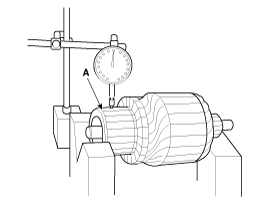

7. Verifique a profundidade do mica (A). Se o mica estiver muito alto (B),
   corte o mica com uma lâmina de sega a laser até a profundidade correta. Corte
   todo o mica (C) entre os segmentos do commutador. O corte não deve ser
   muito superficial, muito estreito ou v-formado (D).

   ```
   Profundidade do mica do commutador
   Padrão (Novo) : 0.5 mm (0.0197 in.)
   Limite : 0.2mm (0.0079 in.)
   ```

   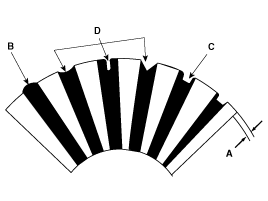

8. Verifique a continuidade entre os segmentos do commutador.
   Se uma circuito aberto existir entre quaisquer segmentos, substitua o armazém.

   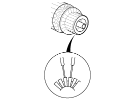

9. Verifique com um ohmímetro que não exista continuidade entre o
   commutador (A) e o núcleo do fio do armazém (B), e entre o commutador
   e o eixo do armazém (C). Se existir continuidade, substitua o armazém.

   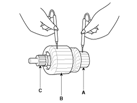

Pente do Iniciador

1. Pentes que estejam desgastados ou imersos em óleo devem ser substituídos.

   ```
   Comprimento do pente
   Padrão : 12.3 mm (0.4843 in)
   Limite de serviço : 5.5 mm (0.2165 in)
   ```

   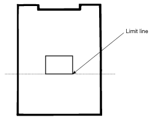

   > **Nota**
   >
   > - Para alinhar novos pentes, passe uma faixa de papel abrasivo #500 ou #600, com o lado abrasivo para cima, entre o commutador e cada pente, e roteie suavemente o armazém. A superfície de contato dos pentes será lixada para a mesma forma do commutador.

Porta-Pentes do Iniciador

1. Verifique se não existe continuidade entre o (+) porta-pentes (A) e o (-) placa (B).

   Se existir continuidade, substitua a montagem do porta-pentes.

   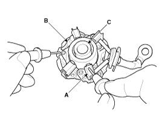

Clutch de Retrocesso

1. Deslize a clutch de retrocesso ao longo do eixo.

   Substitua-a se não deslizar suavemente.

2. Vire a clutch de retrocesso em ambas as direções.

   Ela trava em uma direção e rota em reverso? Se não travar em nenhuma direção
   ou travar em ambas as direções, substitua-a.

   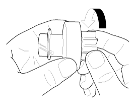

3. Se o pente de transmissão do iniciador estiver desgastado ou danificado, substitua a montagem da clutch de retrocesso. (o pente não está disponível separadamente)

   Verifique a condição do disco de transmissão ou do anel do conversor de torque se os dentes do pente de transmissão do iniciador estiverem danificados.

## Limpeza

1. Não imerga peças em solvente de limpeza.

   Imergir a montagem do yoke e/ou a armadura danificará a isolamento. Limpe essas partes apenas com um pano.

2. Não imerga o conjunto de transmissão em solvente de limpeza.

   O travamento de sobreavaliação está pré-óleo no fábrica e solvente lavará a lubrificação do travamento.

3. O conjunto de transmissão pode ser limpo com um pincel umedecido com solvente de limpeza e secado com um pano.
